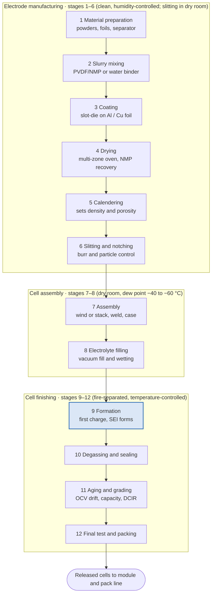

# Module 0 — Roadmap and Line Overview

*Li-ion Cell Manufacturing: an Engineer's Course · as of 27 Oct 2026*

**Goal of this module:** be able to walk a visitor through an entire cell line in ten minutes, name the bottleneck, and say where cost, energy and quality risk sit.

---

## How the course works

Every process module follows the same 11 parts: simple concept → engineering principle → industrial process → process flow → equipment → parameter table → defects → factory example → interview questions → quiz → hands-on exercise.

You already know APQP, PFMEA, SPC and line commissioning from automotive, so the course maps battery practice onto those tools instead of re-teaching them. Pack, BMS and BESS basics are skipped.

### Evidence labels (used in every table)

| Label | Meaning | How to treat it |
| --- | --- | --- |
| **[V] Verified** | Published by a manufacturer, government, peer-reviewed paper or equipment OEM, with a link | Quote with the source |
| **[T] Typical practice** | Range reported across several papers, textbooks or industry guides | A starting window for DOE, not a spec |
| **[E] Estimate** | Engineering estimate made for this course, assumptions stated | Use for sizing and learning only |
| **[P] Proprietary** | Real values exist but cell makers keep them confidential | Get these from your plant's process specification |

A cell plant's recipe (slurry formulation, coating speed, formation protocol) is its core IP. Public numbers give you the window; your line's control plan gives you the target.

---

## Learning roadmap

| # | Module | File | You should be able to… |
| --- | --- | --- | --- |
| 0 | Roadmap and line overview | this file | Walk a visitor through the line in 10 minutes |
| **Phase A** | **Electrode making** | | |
| 1 | Materials and incoming quality | `01-materials-and-incoming-quality.md` | Write incoming specs for NMC, LFP, graphite, foils, separator, electrolyte |
| 2 | Slurry preparation | `02-slurry-preparation.md` | Set a mixing sequence and read a viscosity curve |
| 3 | Coating and drying | `03-coating-and-drying.md` | Size a coater oven; diagnose streaks, cracks, edge build-up |
| 4 | Calendering | `04-calendering.md` | Pick target density/porosity and set roll gap and force |
| 5 | Slitting, notching, cutting | `05-slitting-notching-cutting.md` | Specify burr limits; choose laser vs die notching |
| **Phase B** | **Assembly and finishing** | | |
| 6 | Assembly: winding and stacking | `06-cell-assembly.md` | Compare cylindrical, prismatic and pouch assembly |
| 7 | Electrolyte filling and wetting | `07-electrolyte-filling.md` | Set fill mass, vacuum steps and wetting time |
| 8 | Formation | `08-formation.md` | Explain SEI and design a first-charge protocol |
| 9 | Degassing, aging, grading, final test | `09-degassing-aging-grading-final-test.md` | Use OCV/K-value data to screen micro-shorts |
| **Phase C** | **Factory and quality** | | |
| 10 | Equipment and line integration | `10-equipment-and-line-integration.md` | Build a full equipment list and balance the line |
| 11 | Factory layout and dry rooms | `11-factory-layout-and-dry-rooms.md` | Zone a plant by dew point; plan material flow |
| 12 | Parameter handbook, QC and PFMEA | `12-parameters-quality-pfmea.md` | Write a control plan and PFMEA for a cell line |
| 13 | Defects and failure analysis | `13-defects-and-failure-analysis.md` | Run an 8D on a self-discharge escape |
| **Phase D** | **Business and industry** | | |
| 14 | Economics and factory operations | `14-economics-and-operations.md` | Build a cost-per-kWh model for 1, 5, 10 GWh plants |
| 15 | Global and Indian ecosystem | `15-global-and-indian-ecosystem.md` | Separate announced from operating capacity; map suppliers |
| 16 | Capstone: interview guide, glossary, resources | `16-capstone-interview-glossary-resources.md` | Pass a technical interview; design a 5 GWh line on paper |

**Why this order:** electrode quality sets most of a cell's capacity, resistance and safety, and defects made there cannot be fixed downstream. Learning in line order also matches how you walk a line during commissioning.

**Suggested pace:** Phase A weeks 1–4 · Phase B weeks 5–7 · Phase C weeks 8–10 · Phase D and capstone weeks 11–12 (6–8 hours a week).

### Where each final deliverable lives

| # | Deliverable you asked for | Module |
| --- | --- | --- |
| 1 | Learning roadmap | 0 |
| 2 | Process flowchart | 0 (whole line), 2–9 (per stage) |
| 3 | Equipment list | 10 |
| 4 | Parameter handbook | 12 (consolidated), 2–9 (per stage) |
| 5 | Factory layout explanation | 11 |
| 6 | Defect and troubleshooting guide | 13 |
| 7 | Process FMEA | 12 |
| 8 | Cost model | 14 |
| 9 | Global and Indian ecosystem map | 15 |
| 10 | Interview preparation guide | 16 |
| 11 | Glossary | 16 |
| 12 | Books, papers, videos, courses | 16 |

---

## The line in 12 stages

A cell line has three blocks: **electrode manufacturing** (stages 1–6), **cell assembly** (7–8) and **cell finishing** (9–12). Think of it as a paint shop feeding a body shop feeding an EOL test area: continuous web processes first, then discrete parts, then long electrochemical dwell times.

| # | Stage | What it does | Main equipment | Critical-to-quality parameters | Typical defects | Environment |
| --- | --- | --- | --- | --- | --- | --- |
| 1 | Material preparation | Qualify and condition powders, foils, separator, electrolyte | Silos, vacuum conveying, dryers, gravimetric feeders | Moisture, particle size (D50), purity, magnetic impurities | Metallic contamination, moisture pickup | Controlled, dust-tight |
| 2 | Slurry mixing | Disperse active material, carbon and binder in solvent | Planetary or twin-screw mixer, degassing, filters | Solid content, viscosity, mixing energy, temperature | Agglomerates, gelation, bubbles | Controlled; NMP area solvent-rated |
| 3 | Coating | Lay slurry on Al (cathode) or Cu (anode) foil | Slot-die coater, unwinder, tension control | Wet thickness, areal loading (mg/cm²), edge profile | Streaks, pinholes, edge build-up | Clean, dry |
| 4 | Drying | Evaporate solvent, fix electrode structure | Multi-zone air-flotation oven, NMP recovery | Zone temperatures, air velocity, residual solvent | Cracking, binder migration, delamination | Clean, dry |
| 5 | Calendering | Compress coating to target density and porosity | Two-roll press, gap control, heated rolls | Line force, roll gap, density, thickness | Wrinkles, foil breakage, density variation | Clean, dry |
| 6 | Slitting and notching | Cut mother rolls into lanes, form tabs | Rotary knife slitter, laser or die notcher | Burr height, width tolerance, dust | Burrs, particles, heat-affected zone | Dry room |
| 7 | Assembly | Build stack or jelly roll, weld tabs, case it | Winder or stacker, ultrasonic and laser welders | Alignment, anode overhang, weld strength | Misalignment, separator damage, weak welds | Dry room |
| 8 | Electrolyte filling | Dose electrolyte, wet the pores | Vacuum filling station, soak chambers | Fill mass, vacuum profile, wetting time | Under-fill, splash, moisture ingress | Dry room, tightest dew point |
| 9 | Formation | First charge: build the SEI on the anode | Formation cyclers, pressure fixtures | C-rate, voltage cut-offs, temperature, pressure | Lithium plating, gas, low capacity | Fire-separated, temperature-controlled |
| 10 | Degassing and final seal | Remove formation gas, close the cell for good | Vacuum degas and reseal (pouch), seal pin weld (prismatic) | Vacuum level, seal temperature and time | Leaks, seal wrinkles | Dry room |
| 11 | Aging and grading | Hold cells, measure OCV drift, sort | Aging racks, OCV/IR testers, capacity testers | OCV drop (K-value), capacity, DCIR | Micro-shorts, high self-discharge | Fire-separated, temperature-controlled |
| 12 | Final test and packaging | EOL inspection, labelling, shipment | Vision, insulation tester, leak tester, sorting robots | Voltage window, insulation resistance, dimensions, ID | Escapes, labelling errors | Warehouse with fire protection |

---

## How chemistry changes the process

The line architecture is the same for every chemistry; what changes is powder handling, slurry recipe, moisture tolerance, electrode density and formation. High-nickel NMC/NCA is the most process-sensitive; LFP is the most forgiving but the hardest to disperse.

| Chemistry | Cathode / anode | Process consequences | Moisture sensitivity | Typical formats |
| --- | --- | --- | --- | --- |
| **LFP** | LiFePO₄ (carbon-coated, fine particles) / graphite | High surface area needs more carbon and binder and lower slurry solids; dispersion is the main mixing challenge; lower calendered density than NMC **[T]** | Moderate | Large prismatic, blade, increasingly 46-series cylindrical |
| **NMC** (532 → 811) | LiNi_xMn_yCo_zO₂ / graphite (± silicon) | Dense electrodes, high calendering force; residual lithium on high-Ni powder can gel PVDF/NMP slurry, so powder stays dry and slurry pot life is short **[T]** | High, rising with Ni | Cylindrical, pouch, prismatic |
| **NCA** | LiNiCoAlO₂ / graphite-silicon | Behaves like high-Ni NMC: strict powder dryness, tight dew point | Very high | Mainly cylindrical |
| **LTO** | NMC or LMO / Li₄Ti₅O₁₂ | Anode works above the SEI potential, so formation is short and gentle; anode can sit on Al foil; low energy density | Low–moderate | Niche prismatic and cylindrical |
| **Sodium-ion** | Layered oxide or Prussian-blue analogue / hard carbon | Largely drop-in on Li-ion lines; Al foil on both electrodes cuts cost and allows shipping at 0 V; Prussian-blue cathodes need strict water removal **[T]** | Oxide cathodes high | Cylindrical, prismatic |

**For your PFMEA:** chemistry mostly moves the severity and occurrence scores at mixing, drying and dry-room stages. A high-Ni line needs tighter powder-moisture and dew-point controls than an LFP line of the same output.

## How cell format changes the line

Format changes only stages 7–10. Electrode making is nearly identical, except for electrode width and notching pattern.

| | Cylindrical | Prismatic | Pouch |
| --- | --- | --- | --- |
| Electrode build | Continuous winding into a jelly roll | Flat winding or stacking | Stacking (Z-fold or lamination-stack) |
| Line character | Very high speed, many small cells **[T]** | Fewer, large cells; stacking/winding is the assembly bottleneck | Like prismatic, plus pouch forming |
| Tab joining | Tabbed or tabless (full-edge); laser welding to can and cap | Ultrasonic pre-weld of foil bundles, laser weld to terminals | Ultrasonic weld of foil bundles to tab leads |
| Housing | Deep-drawn steel or Al can; crimped or welded cap | Al can, laser-welded lid | Al-laminate pouch, heat-sealed |
| Filling | Before closing | Through fill port; often two fills | Before sealing, with a gas pocket |
| Degassing | None after closing | Through fill port, then seal pin welded | Pierce gas pocket, vacuum, reseal, trim |
| Main risks | Winding telescoping, weld spatter, core burrs | Stack alignment, lid weld porosity | Seal integrity, swelling, pouch damage |

---

## Where cost, energy, time and yield sit

| Lever | What the sources say | Label | Source |
| --- | --- | --- | --- |
| Energy: coating and drying | Coating and drying including NMP recovery about 46% of production energy and about 11.5% of manufacturing cost | [V] research estimate | [EEPower on ORNL study](https://eepower.com/market-insights/researchers-validate-benefits-of-dry-processing-in-lithium-ion-battery-manufacturing/) |
| Energy: whole plant | 2 GWh prismatic NMC333 plant model: ~44.6 Wh of energy per Wh of cell capacity, dominated by drying and dry room | [V] model | [SINTEF, Batteries 2021](https://sintef.no/en/publications/publication/1892466) |
| Time: formation | PEM RWTH: forming is one of the most time-consuming and energy-intensive steps | [V] | [Battery-News](https://battery-news.de/?p=26488) |
| Time: wetting + formation | Industry protocol cited by ORNL: total ~3–7 days excluding aging | [V] | [Wood, NAATBatt 2019](https://assets-002.noviams.com/novi-file-uploads/naatbatt/Conference_Material/2019/W2-D_Wood_NAATBatt-2019-Presentation_Final.pdf) |
| Time: incl. aging | Industry sources cite ~1.5 to 3 weeks from first charge to release | [T] | [Oxmaint](https://oxmaint.com/blog/post/ev-battery-manufacturing-plant-maintenance-dry-room-coating-formation) |
| Yield | New lines ramp over 12–24 months from low yields; real numbers rarely published | [E]/[P] | Module 14 |

**Engineer's takeaways:**

1. Scrap at grading costs the full material plus 1–3 weeks of rack time. Catch defects at coating and calendering, where scrap is cheapest.
2. Dry-room air volume and leakage are an OPEX line you can engineer down.
3. Formation-rack count, not the coater, often caps plant output.

## Factory environment primer

| Zone | Typical dew point | Why | Label |
| --- | --- | --- | --- |
| Mixing and coating | Humidity-controlled; drier for high-Ni | Powders and slurry pick up water; NMP is a solvent hazard | [T] |
| Electrode handling, slitting, notching | about −35 to −45 °C | Absorbed water reacts with electrolyte later | [T] |
| Assembly and filling | −40 °C common, down to −60 °C for sensitive chemistries | LiPF₆ + H₂O → HF, which attacks SEI and cathode | [T] |
| Formation and aging | Normal humidity; strict temperature and fire separation | Cells are sealed; risk is now thermal | [T] |

Sources: [AFRY](https://afry.com/en/insight/clean-room-atmosphere-requirements-battery-production) (−35 to −45 °C during assembly), [igus whitepaper](https://blog.igus.ca/wp-content/uploads/2026/05/USA_dry-cleanroom-batteries_whitepaper.pdf) (1% RH ≈ −40 °C dew point), [Cleanroom Technology / ABN](https://www.cleanroomtechnology.com/abn-launches-ready-to-use-low-dewpoint-cleanroom-solution-for-the-eu-208283) (−40 °C standard, −60 °C option).

**Automotive parallel:** treat dew point like booth temperature and humidity in a paint shop — a process parameter with an SPC chart, alarm limit and reaction plan, not a facilities metric.

---

## Module 0 check

**Interview questions**
1. Walk me through a cell line from powder to shipped cell, and name the bottleneck.
2. Why is cathode slurry usually PVDF in NMP while anode slurry is water-based?
3. Why do assembly and filling need a lower dew point than coating?
4. What is formation, and why can't it be skipped or rushed?
5. Why is a defect found at grading much more expensive than one found at coating?
6. How does moving from NMC to LFP change your PFMEA?

**Quiz**
1. Which foil carries the anode, and why can sodium-ion cells use aluminium on both sides?
2. Name the two steps that dominate plant energy use.
3. In which stage does the SEI form?
4. Which format needs degassing through a gas pocket?
5. What does a high OCV drop during aging usually indicate?
6. What does the K-value measure?
7. Which build method is continuous and fastest: winding or stacking?
8. Under ACC PLI, how much capacity was commissioned on time by October 2025?

**Hands-on exercise:** on one page, sketch a process flow for a 5 GWh LFP prismatic plant. For each of the 12 stages write (a) the one parameter you would put on an SPC chart first, (b) the defect you most fear, (c) the room class. Keep it — it becomes your control-plan skeleton in Module 12.

Quiz answers

1. Copper. Lithium alloys with aluminium at anode potentials; sodium does not, so Al works for both electrodes.
2. Electrode drying (with NMP recovery) and dry-room air conditioning.
3. Formation (stage 9).
4. Pouch.
5. A self-discharge problem, often a micro-short from a particle or burr.
6. The rate of OCV drop over time during aging, usually in mV/day.
7. Winding.
8. 1.4 GWh (2.8% of 50 GWh), all by Ola Electric ([IEEFA](https://ieefa.org/articles/only-28-target-capacity-delivered-yet-under-indias-battery-manufacturing-incentive-scheme)).

**Next:** [Module 1 — Materials and incoming quality](01-materials-and-incoming-quality.md)
