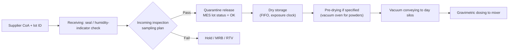

# Module 1 — Materials and Incoming Quality (Stage 1)

*Li-ion Cell Manufacturing: an Engineer's Course · Phase A · Evidence labels: [V] verified · [T] typical practice · [E] estimate · [P] proprietary*

**Bottom line:** roughly three-quarters of a cell's cost is material, and most field failures trace back to something that came in on a truck — a metallic particle, a wet powder, a thin spot in the separator. Incoming quality in a cell plant is closer to semiconductor practice (ppb-level contamination) than to automotive sheet-metal practice.

---

## 1. The concept in simple language

A cell is a sandwich: a **cathode** (active powder glued to aluminium foil), a **separator** (porous plastic film), an **anode** (graphite glued to copper foil), all soaked in **electrolyte** (a lithium salt in organic solvents) and sealed in a **can or pouch**. Every layer must be pure, dry and dimensionally consistent, because the layers are only tens of microns thick and a single 50 µm metal particle can bridge them.

## 2. Engineering principle

Three properties govern almost every incoming specification:

1. **Electrochemical purity.** Foreign metals (Fe, Cu, Zn, Cr, Ni as free metal) dissolve at the cathode potential, migrate and re-deposit on the anode as dendrites → micro-short → self-discharge or thermal event. Hence **magnetic-impurity limits at ppb level**.
2. **Moisture.** Water + LiPF₆ → HF. HF attacks the cathode, dissolves transition metals and damages the SEI. Every hygroscopic material (cathode powder, separator, binder, electrolyte) carries a water spec.
3. **Particle and surface morphology.** Particle size (D10/D50/D90), specific surface area (BET) and tap density decide how much binder and carbon the slurry needs, how dense the electrode can be calendered, and how much lithium is lost forming the SEI.

## 3. Bill of materials of a typical cell

Indicative mass shares for an EV-type cell **[T]**: cathode active material is the largest single item (roughly 30–45% of cell mass for NMC; LFP's lower energy density means more of it per kWh), anode active material ~15–20%, electrolyte ~10–15%, foils ~10–15%, separator ~2–4%, housing and terminals the rest. Use your own cell's BOM for anything real.

## 4. Material-by-material specification

### 4.1 Cathode active materials (CAM)

| Item | LFP | NMC (532/622/811) | NCA |
| --- | --- | --- | --- |
| Composition | LiFePO₄, carbon-coated (1–3% C) **[T]** | LiNi_xMn_yCo_zO₂ | LiNi₀.₈Co₀.₁₅Al₀.₀₅O₂ (typical) |
| Function | Li source / host on charge-discharge | same | same |
| Key properties | Fine primary particles (sub-µm) aggregated to a few µm; high BET; ~3.2–3.3 V plateau | D50 ~ 3–15 µm secondary spheres or single-crystal; 3.6–3.7 V nominal | Similar to high-Ni NMC |
| Critical specs | D10/D50/D90, BET, tap density, carbon content, Fe²⁺/Fe³⁺ phase purity, moisture, magnetic impurities | Same plus **residual lithium (LiOH + Li₂CO₃)**, cation mixing, pH | Same as NMC; residual Li critical |
| Moisture sensitivity | Moderate | High; rises with Ni | Very high |
| Storage | Sealed bags, dry store | Sealed, nitrogen or dry-air, FIFO, limited exposure time after opening **[T]** | As high-Ni |
| Common defects | Off-spec carbon coating, Fe impurities, agglomerates | Residual Li too high (gels PVDF slurry), surface carbonate, cracked secondaries, metallic Fe from processing | Same |
| Global suppliers | Hunan Yuneng, Shenzhen Dynanonic, Wanrun, Lopal **[T]** | Umicore, BASF, EcoPro BM, L&F, POSCO Future M, Ronbay, Easpring **[T]** | Sumitomo Metal Mining, EcoPro BM **[T]** |
| India | Altmin (Telangana, ₹750 cr plant under construction); Himadri (Odisha, 40,000 t/yr targeted by late 2027); Gujarat Fluorochemicals (small LFP line commissioned) **[V]** | No commercial-scale Indian NMC CAM yet reported **[T]** | — |

India sources: [Swarajya, 2026](https://swarajyamag.com/technology/cathode-anode-separator-foil-electrolyte-can-government-incentives-help-india-crack-the-battery-code).

### 4.2 Anode active materials

| Item | Graphite (natural / synthetic) | Silicon additives | Hard carbon (Na-ion) | LTO |
| --- | --- | --- | --- | --- |
| Composition | C, spheroidised natural or synthetic (from needle coke) | SiOx or Si-C composite, a few % blended into graphite **[T]** | Disordered carbon from biomass/resin | Li₄Ti₅O₁₂ |
| Key properties | D50 ~10–20 µm, BET low (~1–4 m²/g), high first-cycle efficiency **[T]** | Large volume change on lithiation; low first-cycle efficiency | High irreversible capacity | Zero-strain, 1.55 V vs Li |
| Critical specs | D50, BET, tap density, ash content, magnetic impurities, first-cycle efficiency | Si content, particle size | Same as graphite | Same |
| Defects | High BET → more SEI loss; metallic impurities; off-spec coating | Swelling, cracking | High ICL | — |
| Global suppliers | BTR, Shanshan, Putailai, Shangtai, POSCO Future M **[T]** | Shin-Etsu, BTR, Sila, Group14 **[T]** | Kuraray, Chinese makers **[T]** | Toshiba (cells) **[T]** |
| India | Epsilon Advanced Materials (Karnataka; anode qualification plant; ₹145 cr incentive); HEG and Graphite India investing in anode plants **[V]** | — | — | — |

### 4.3 Conductive additives

| Item | Carbon black | CNT (carbon nanotubes) | Graphene / VGCF |
| --- | --- | --- | --- |
| Function | Electronic bridges between active particles | Long conductive network at low loading | Niche |
| Typical loading | 1–3% of electrode dry mass **[T]** | 0.5–1% (often as pre-dispersed paste) **[T]** | — |
| Key specs | BET, oil absorption, ash, metals | Purity, dispersion quality, residual catalyst metals (Fe, Co) | — |
| Suppliers | Imerys (Super P / C-NERGY), Cabot, Orion, Denka **[T]** | Cnano, LG Chem, OCSiAl **[T]** | — |
| Watch-out | Hard to wet; agglomerates | Catalyst metal residues are a self-discharge risk | — |

### 4.4 Binders and solvents

| Item | PVDF + NMP (cathode) | CMC + SBR + water (anode) | Alternatives |
| --- | --- | --- | --- |
| Composition | Polyvinylidene fluoride dissolved in N-methyl-2-pyrrolidone | Carboxymethyl cellulose (thickener/dispersant) + styrene-butadiene rubber latex (binder) | PAA, water-based cathode binders, PTFE (dry process) |
| Typical loading | 1–4% PVDF (cathode dry mass) **[T]** | ~1–2% CMC + ~1–2% SBR **[T]** | — |
| Key specs | PVDF molecular weight, moisture; NMP purity ≥99.5–99.9%, water <~200 ppm **[T]** | CMC degree of substitution and viscosity; SBR solids, particle size; water conductivity (DI water) | — |
| Why | PVDF is stable at cathode potential; NMP dissolves it | Cheap, low-tox, stable at anode potential | Remove NMP cost and hazard |
| Hazards | NMP is reprotoxic; needs recovery and exposure control | Low | — |
| Suppliers | PVDF: Arkema, Syensqo (Solvay), Kureha, Dongyue · NMP: BASF, Mitsubishi Chemical, Chinese makers **[T]** | CMC: Ashland, Nippon Paper, Daicel · SBR: Zeon, JSR (now ENEOS Materials), LG Chem **[T]** | — |
| India | Gujarat Fluorochemicals produces fluoropolymers incl. battery-grade PVDF plans **[T — verify]** | Domestic CMC makers exist for other industries **[T]** | — |

### 4.5 Electrolyte

| Item | Detail |
| --- | --- |
| Composition | ~1.0–1.2 M LiPF₆ in carbonate blend (EC + EMC/DMC/DEC) plus 1–5% additives (VC, FEC, LiDFOB, PS, etc.) **[T]** |
| Function | Ionic path between electrodes; additives shape SEI/CEI |
| Key specs | **Water < ~20 ppm, free acid (HF) < ~50 ppm [T]**, colour (APHA), conductivity, density, metal ions |
| Storage | Stainless drums/ISO tanks under dry N₂ or Ar; temperature-controlled; FIFO; shelf-life tracked |
| Defects | Water pickup → HF; discolouration (LiPF₆ decomposition); wrong additive dosing |
| Global suppliers | Tinci, Capchem, Guotai-Huarong, Enchem, Soulbrain, Mitsubishi Chemical **[T]** |
| India | Gujarat Fluorochemicals produces LiPF₆ commercially at Dahej; Neogen Chemicals makes electrolyte under licence (MU Ionic Solutions) and is building LiPF₆ with Morita **[V]** |

### 4.6 Separator

| Item | Detail |
| --- | --- |
| Composition | PE (wet process) or PP / PP-PE-PP (dry process) microporous film, usually ceramic-coated (Al₂O₃ or boehmite) and/or PVDF/aramid-coated **[T]** |
| Function | Electronic insulator, ionic conductor, thermal shutdown |
| Key specs | Thickness 9–25 µm (EV often 9–16 µm + coating), porosity ~35–50%, Gurley (air permeability), puncture strength, MD/TD shrinkage at 90–130 °C, shutdown temperature (~130 °C for PE), moisture **[T]** |
| Defects | Pinholes, gels, thin spots, coating flakes, wrinkles, static charge |
| Storage | Dry room or sealed with desiccant; temperature-limited to avoid shrinkage |
| Global suppliers | SEMCORP (Yunnan Energy New Material), Asahi Kasei, SK IE Technology, Toray, Senior, Sinoma **[T]** |
| India | TCPL Packaging announced entry; no Indian Li-ion separator plant yet in commercial production **[V]** |

### 4.7 Current collector foils

| Item | Aluminium foil (cathode) | Copper foil (anode) |
| --- | --- | --- |
| Thickness | ~10–20 µm (12–15 µm common) **[T]** | ~4.5–10 µm (6–8 µm common) **[T]** |
| Process | Rolled (1xxx series alloys); some carbon-primed | Electrodeposited (ED) mostly; some rolled |
| Key specs | Thickness tolerance, tensile strength and elongation, pinholes, surface cleanliness (oil residue → poor adhesion), wettability (dyne) | Same plus roughness (Rz) both sides, oxidation/anti-tarnish layer |
| Defects | Pinholes, oil stains, edge waviness, wrinkles | Oxidation spots, pinholes, low elongation (cracks in winding) |
| Global suppliers | Dingsheng, Wanshun, UACJ, Showa Denko, Hindalco (Al) **[T]** | Nuode, Jiayuan, Lingbao Wason, SK Nexilis, Lotte Energy Materials, Solus **[T]** |
| India | Hindalco battery-grade aluminium foil (Odisha) and an announced 11,500 t copper-foil plant at Waghodia, Gujarat **[V]** |

### 4.8 Housings and terminals

| Item | Detail |
| --- | --- |
| Cylindrical | Deep-drawn Ni-plated steel can (or Al), cap assembly with CID, PTC and vent **[T]** |
| Prismatic | Deep-drawn or impact-extruded aluminium can (3003 alloy common), laser-welded lid with terminals, vent, fill port **[T]** |
| Pouch | Al-laminate film: nylon / aluminium / CPP (polypropylene) ~ 110–160 µm **[T]**; tab leads Al and Ni-plated Cu with sealant film |
| Key specs | Can wall thickness, flatness, burrs, cleanliness, vent burst pressure, laminate peel strength and pinholes |
| Suppliers | Cans and caps: Kedali, Shenzhen Everwin **[T]**; laminate film: DNP, Resonac (formerly Showa Denko), Zijiang **[T]** |
| India | Few dedicated battery-can suppliers yet; Indian deep-drawing and stamping base is a localisation opportunity **[E]** |

---

## 5. Process flow: receipt to line-side

## 6. Equipment for material handling

| Equipment | Principle | Key parameters | Watch-outs |
| --- | --- | --- | --- |
| Big-bag / drum unloading stations | Contained discharge under extraction | Dust containment, operator exposure | Cross-contamination between cathode and anode materials — physically separate lines |
| Vacuum or dense-phase pneumatic conveying | Powder moved by gas pressure difference | Gas dryness (dew point), velocity (attrition of secondary particles), wear | Conveying NMC too fast cracks secondary particles **[T]** |
| Magnetic separators / demagnetisers | Permanent or electromagnet traps ferrous particles | Field strength (gauss), cleaning frequency | Must be validated with test pieces; record catches |
| Sieves (ultrasonic) | Removes oversize agglomerates/foreign matter | Mesh size | Screen wear sheds metal — inspect |
| Vacuum dryers | Remove adsorbed moisture | Temperature, vacuum, time | Over-drying binder/CMC can degrade |
| Gravimetric loss-in-weight feeders | Dose by weight loss rate | Accuracy, refill strategy | Calibrate under MSA |

Material contact parts are typically ceramic-lined, tungsten-carbide or polymer-coated, and copper/zinc/brass is banned from cathode material contact to avoid metal contamination **[T]**.

## 7. Incoming inspection methods

| Test | Applies to | Method / instrument | Why |
| --- | --- | --- | --- |
| Particle size distribution | CAM, AAM, carbon | Laser diffraction (D10/D50/D90) | Packing, rate capability, calendering |
| Specific surface area | CAM, AAM, carbon | BET N₂ adsorption | Binder demand, SEI loss |
| Tap density | CAM, AAM | Tap tester | Achievable electrode density |
| Moisture | All powders, separator, binder | Karl Fischer coulometric (oven method) | HF formation |
| Residual lithium / pH | High-Ni CAM | Acid–base titration | Slurry gelation |
| Magnetic impurities | CAM, AAM, carbon | Magnetic extraction + ICP-OES/MS | Micro-shorts |
| Elemental composition | CAM, electrolyte | ICP-OES | Stoichiometry, contaminants |
| Phase purity | CAM | XRD | Correct crystal structure |
| Morphology | CAM, AAM | SEM | Cracks, fines, coating |
| Electrolyte water / HF | Electrolyte | Karl Fischer; acid titration | HF control |
| Separator | Separator | Thickness gauge, Gurley, puncture, shrinkage oven, pinhole optical scan | Short-circuit protection |
| Foil | Al, Cu | Micrometer, tensile tester, dyne pens, pinhole light table | Adhesion, winding cracks |
| Electrochemical check | CAM, AAM | Coin-cell test (capacity, first-cycle efficiency) | Final functional gate |

## 8. Common material defects and their effects

| Defect | Detection | Effect in cell | Containment / prevention |
| --- | --- | --- | --- |
| Metallic particle (Fe, Cu, Zn) in powder | Magnetic extraction + ICP; later as OCV drop | Micro-short, high self-discharge, possible thermal event | Supplier magnet/sieve controls, incoming test, line magnets |
| High residual Li on NMC | Titration | Slurry gelation, gassing in formation | Dry storage, limited exposure time, supplier washing/coating spec |
| Wet powder | Karl Fischer | HF, capacity fade, gas | Sealed packaging, dew-point-controlled storage, pre-drying |
| Separator pinhole / thin spot | Optical inline scan at supplier; hi-pot after assembly | Hard short | Supplier inspection data per roll; incoming audit |
| Foil oil residue | Dyne test | Coating delamination | Supplier cleaning spec |
| Electrolyte with high HF | Titration | Fade, gas | Supplier spec, storage temperature control |

## 9. Factory example

A cathode line in a new plant shows rising OCV-drop rejects at aging three weeks after a CAM lot change. The 8D finds the supplier changed a conveying hose to a cheaper grade that shed fine stainless particles. Incoming magnetic-impurity testing had used a sampling frequency of one sample per 10 lots. **Fix:** test every lot for magnetic impurities for 3 months after any supplier change notification (PCN), and add a supplier PCN clause to the PPAP. This mirrors automotive PPAP re-submission on process changes.

## 10. Interview questions

1. Why are magnetic-impurity limits for cathode material expressed in ppb and not ppm?
2. What is residual lithium, why does it matter for PVDF slurries, and how do you measure it?
3. Which incoming tests would you require for a new separator supplier?
4. How does BET surface area of graphite affect first-cycle efficiency?
5. Why is copper foil electrodeposited while aluminium foil is rolled?
6. How would you write a PPAP for a cathode material supplier?

## 11. Quiz

1. Name the three components of a typical Li-ion electrolyte.
2. What is the typical water limit for electrolyte?
3. Why is brass banned from cathode-powder contact parts?
4. What do CMC and SBR each do in the anode slurry?
5. Which separator property gives thermal shutdown?
6. Which Indian company produces LiPF₆ commercially?

Answers

1. Lithium salt (LiPF₆), carbonate solvents (EC + linear carbonates), additives (e.g. VC, FEC).
2. On the order of 20 ppm **[T]**.
3. Copper and zinc dissolve at cathode potential and re-plate on the anode, causing shorts.
4. CMC thickens and disperses; SBR binds.
5. PE melting (~130 °C) closes the pores.
6. Gujarat Fluorochemicals (Dahej).

## 12. Hands-on exercise

Draft an **incoming inspection plan** for an LFP cathode powder: list each characteristic, specification (use [T] windows from this module and mark them "to be agreed with supplier"), test method, sample size and frequency, reaction plan, and whether it is a special characteristic (SC/CC). Then do the same for a ceramic-coated separator. Keep both; they feed the control plan in Module 12.

## Sources

- [Swarajya — Indian cathode, anode, separator, foil, electrolyte makers (2026)](https://swarajyamag.com/technology/cathode-anode-separator-foil-electrolyte-can-government-incentives-help-india-crack-the-battery-code)
- [PEM RWTH & VDMA — Production Process of a Lithium-Ion Battery Cell, 5th ed.](https://battery-news.de/en/2026/02/12/pem-and-vdma-update-guide-to-battery-cell-production/)
- [Liu et al., iScience 2021](https://doi.org/10.1016/j.isci.2021.102332)
- Supplier names marked [T] are widely reported industry players listed from general knowledge; confirm current status before quoting.

**Next:** [Module 2 — Slurry preparation](02-slurry-preparation.md)
