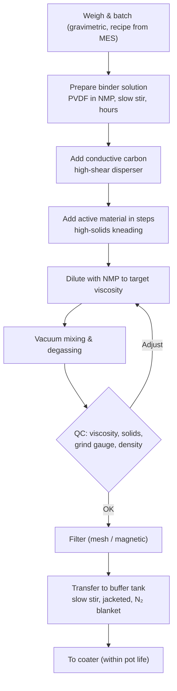

# Module 2 — Slurry Preparation (Stage 2)

*Li-ion Cell Manufacturing: an Engineer's Course · Phase A · Evidence labels: [V] verified · [T] typical practice · [E] estimate · [P] proprietary*

**Bottom line:** the slurry fixes the electrode's microstructure before it ever touches foil. If carbon is not broken down and spread around the active particles, no amount of coating or calendering skill recovers the lost conductivity. Treat the mixer like a paint-shop mixing room: batch records, viscosity windows, pot life and filtration are all control-plan items.

---

## 1. The concept in simple language

You are making a very thick, very clean "paint": active powder (the pigment), conductive carbon (makes it conduct), binder (makes it stick) and solvent (makes it flow). The aim is a homogeneous, bubble-free, agglomerate-free paste with the right viscosity to coat, which stays stable until it is coated.

## 2. Engineering principle

- **Dispersion = breaking agglomerates + stabilising the pieces.** Carbon black arrives as agglomerates of nano-particles; shear energy breaks them; binder adsorbs on the surface and stops them re-agglomerating.
- **Order of addition matters.** What touches the binder solution first gets coated first. Carbon is usually dispersed into the binder solution before the large active particles go in, so carbon ends up as a conductive network around them **[T]**.
- **Mixing intensity has an optimum.** Too little → agglomerates and poor conductivity. Too much → NMC secondary particles crack, carbon chains are shredded to over-fine particles that soak up binder, SBR latex is destabilised, and temperature rises **[T]**.
- **Rheology is shear-thinning.** The slurry must be viscous at rest (no settling) and thin under the shear of the coating die. You control viscosity at a defined shear rate, not one number.
- **Solids content is an economic and drying lever.** Higher solids = less solvent to evaporate in Stage 4 = lower energy and less cracking, but harder to process.

## 3. Cathode vs anode slurry

| | Cathode (NMC, LFP) | Anode (graphite) |
| --- | --- | --- |
| Binder system | PVDF dissolved in NMP | CMC (dispersant/thickener) + SBR latex (binder) in deionised water |
| Typical solids **[T]** | NMC ~65–75 wt%; LFP lower, ~45–60 wt% (high surface area) | ~40–55 wt% |
| Typical dry formulation **[T]** | NMC: ~94–97% CAM, 1.5–3% carbon, 1.5–3% PVDF · LFP: ~90–95% CAM, 2–5% carbon, 2–5% PVDF | ~95–97% graphite, 0–1% carbon, 1–2% CMC, 1–2% SBR |
| Key sensitivities | Moisture and residual Li (high-Ni) → **gelation** (PVDF cross-links under base) | SBR is shear- and temperature-sensitive; pH; foaming |
| Solvent handling | NMP: reprotoxic, recovered and recycled | DI water |
| Alternatives | Water-based cathode binders (LFP easier), dry electrode (PTFE fibrillation) | Same water route; PAA binders for Si |

## 4. The industrial process

### 4.1 Batch process (planetary mixer) — cathode example

Steps in practice:

1. **Weighing and batching.** Gravimetric feeders, recipe pulled from MES, every weight recorded against batch ID. Powders arrive from day silos by vacuum conveying.
2. **Binder solution.** PVDF dissolved in NMP at ~5–10 wt% **[T]** for hours under slow agitation; must be clear and gel-free. Anode: CMC dissolved in DI water (~1–2 wt% solution) **[T]**.
3. **Conductive additive dispersion.** Carbon black or CNT paste into binder solution under high shear (disperser blade or rotor-stator).
4. **Active material addition.** Added in portions. Many recipes use a **high-solids kneading** phase (paste-like) to put high shear energy into the mix, then dilute **[T]**.
5. **Dilution** to target viscosity with solvent.
6. **Vacuum mixing and degassing** at low speed to remove entrained air (bubbles become pinholes on the coater).
7. **QC sampling:** viscosity, solids, grind gauge, density.
8. **Filtration** through mesh (and often magnetic) filters to remove agglomerates and metallic debris.
9. **Transfer and storage** in jacketed buffer tanks with slow stirring; pot life tracked.

**Anode-specific:** SBR is added **last, at low shear**, because high shear breaks the latex emulsion **[T]**.

### 4.2 Continuous process (twin-screw extruder)

Powders and liquids are fed continuously into a co-rotating twin-screw extruder whose screw sections convey, knead and disperse; slurry exits continuously. Benefits: smaller footprint, consistent energy input, less waiting time, lower inventory; challenges: precise powder feeding, start-up scrap, cleaning. Bühler and Coperion are established suppliers; Dürr lists semi-continuous systems of 1–960 L/h and continuous systems of 20–2,000 kg/h **[V]** ([Dürr brochure](https://www.durr.com/fileadmin/durr.com/04_Company/01_Events/2019/duerr-advanced-battery-brochure.pdf)).

### 4.3 Dry-mixing variants

- **Dry pre-mix:** active material + carbon mixed dry (intensive mixer) so carbon coats particles before solvent is added. Shortens wet mixing.
- **Dry electrode process:** no solvent at all; PTFE binder fibrillated under shear, powder calendered into a free-standing film and laminated onto foil. Removes the coater oven and NMP recovery (the biggest energy users). Still being industrialised; Module 3 returns to it.

## 5. Equipment

| Equipment | Working principle | Main components | Key parameters | Common failures | Suppliers **[T]** |
| --- | --- | --- | --- | --- | --- |
| Double-planetary mixer (+ high-speed disperser) | Two blades orbit and spin; disperser shaft adds high shear | Bowl (jacketed), planetary blades, disperser, vacuum pump, scraper | Planetary rpm, disperser tip speed, time per step, temperature, vacuum | Seal leakage, blade wear (metal shedding), temperature control drift | Inoue, PRIMIX, Ross, Dürr; Chinese makers |
| Twin-screw extruder | Continuous kneading in screw elements | Barrel zones, screws, gravimetric feeders, liquid pumps | Screw speed, throughput, specific energy, barrel temperature | Feeder inaccuracy, screw wear | Bühler, Coperion |
| Intensive dry mixer | Rotating pan and rotor | Pan, rotor | Tip speed, time | Wear | Eirich, Hosokawa |
| Bead mill (for CNT pastes) | Grinding media | Chamber, beads | Bead size, energy | Media wear contamination | Netzsch, Bühler |
| Binder dissolving tank | Slow agitation | Jacketed tank | Time, temperature | Undissolved gel | Many |
| Degassing / buffer tanks | Vacuum and slow stirring | Jacketed vessel, anchor stirrer | Vacuum, stir speed, temperature | Settling | Many |
| Filters | Mesh + magnetic | Bag/cartridge, magnet bars | Mesh size, ΔP | Clogging, bypass | Many |
| Inline viscometer / density meter | Rotational or vibrational | Sensor | — | Fouling | Anton Paar, Brookfield (AMETEK) |

Wear parts that touch slurry are often ceramic-coated or tungsten-carbide to prevent metallic contamination **[T]**.

## 6. Parameter table

| Parameter | Typical range | Purpose | Effect if off | Measurement | Control | Label |
| --- | --- | --- | --- | --- | --- | --- |
| Solids content (NMC cathode) | ~65–75 wt% | Coating weight, drying load | Low → cracking, more energy; high → poor flow, streaks | Moisture balance (gravimetric drying) | Solvent addition | [T] |
| Solids content (LFP cathode) | ~45–60 wt% | As above | As above | As above | As above | [T] |
| Solids content (graphite anode) | ~40–55 wt% | As above | As above | As above | As above | [T] |
| Viscosity at defined shear (e.g. 10–50 s⁻¹) | Roughly 1–10 Pa·s, recipe-specific | Coatability, no settling | Low → edge flow, settling; high → streaks, bubbles trapped | Rotational viscometer, defined temperature | Solvent dilution | [T] / [P] for exact window |
| Grind gauge (fineness) | Max particle typically below ~30–50 µm | No agglomerates bigger than coating thickness | Agglomerates → streaks, protrusions, separator puncture | Hegman gauge | Dispersion energy, filter mesh | [T] |
| Slurry temperature | Kept roughly ≤ 40 °C | Avoid binder/solvent issues, gelation, SBR damage | Viscosity drift, gel | Jacket temperature sensor | Cooling jacket | [T] |
| Vacuum during degassing | Near full vacuum (e.g. −0.08 to −0.095 MPa gauge) | Remove air | Bubbles → pinholes | Gauge | Pump, time | [T] |
| Mixing time/speed per step | Hours (batch) vs minutes residence (continuous) | Dispersion | Under/over-mixing | Recipe log | MES recipe lock | [P] |
| Pot life | Hours to a day; shorter for high-Ni | Avoid gelation and settling | Viscosity rise, gel particles | Viscosity re-check | FIFO, max hold time | [T] / [P] |
| Water content in NMP slurry | Low hundreds of ppm | Prevent gelation & HF | Gelation | Karl Fischer | Dry materials, closed system | [T] |

## 7. Common slurry defects

| Defect | Root causes | Detection | Effect downstream | Prevention |
| --- | --- | --- | --- | --- |
| Agglomerates | Insufficient shear, carbon added too fast, wrong sequence | Grind gauge, filter ΔP rise | Streaks, protrusions, separator damage, local resistance | Sequence, dispersion energy, filtration |
| Gelation (NMP slurries) | Residual Li/base on high-Ni CAM, moisture, long hold, heat | Viscosity rising with time, gel particles | Unusable batch, coating defects | Dry powders, low-residual-Li CAM, temperature and pot-life control, acid additives **[T]** |
| Sedimentation | Viscosity too low at rest, long storage without stirring | Solids difference top/bottom | Loading variation along roll | Rheology design, slow stirring |
| Bubbles | Air entrainment, insufficient degassing | Visual, density | Pinholes, craters | Vacuum degassing, closed transfer |
| SBR demulsification | High shear or temperature after SBR addition | Grit, viscosity change | Poor adhesion, agglomerates | Add SBR last at low shear |
| Metallic contamination | Wear of blades, seals, pumps | Magnetic filter catches, ICP | Micro-shorts | Ceramic/WC wear parts, magnets, PM checks |
| Viscosity drift | Temperature, solvent evaporation, ageing | Inline viscometer | Coating weight drift | Closed tanks, jacket control, re-check before use |

## 8. Factory example

An NMC811 cathode line sees viscosity rising 30–40% within four hours of discharge, then gel lumps blocking the coater filter. Investigation: a new CAM lot met spec but was opened in a corridor at ambient humidity for a shift change; residual LiOH rose and moisture entered the slurry. **Actions:** limit opened-bag exposure time (alarm in MES), keep CAM in the dry zone end-to-end, add a viscosity-versus-time check at 2 h, reduce pot life for high-Ni recipes. In automotive language: a material-handling special characteristic was missing from the PFMEA.

## 9. Interview questions

1. Why is carbon black usually dispersed into the binder solution before the active material is added?
2. What causes PVDF/NMP slurry gelation with high-nickel cathodes, and how do you prevent it?
3. Why is SBR added last in an anode slurry?
4. Batch planetary vs continuous twin-screw mixing: when would you choose each?
5. Which slurry properties would you put on SPC charts, and why viscosity at a defined shear rate rather than a single value?
6. What does a rising filter differential pressure tell you?

## 10. Quiz

1. Typical solids content of an NMC cathode slurry?
2. What does a Hegman gauge measure?
3. Which binder system is used for graphite anodes?
4. Name two consequences of over-mixing.
5. Why degas under vacuum?

Answers

1. Roughly 65–75 wt% **[T]**.
2. Fineness of grind — largest particles/agglomerates in the slurry.
3. CMC + SBR in deionised water.
4. Cracked NMC secondaries, shredded carbon soaking up binder, SBR damage, temperature rise.
5. Entrained air becomes pinholes and craters in the coating.

## 11. Hands-on exercise

Write a **mixing work instruction and control plan extract** for a 1,000 L batch of LFP cathode slurry: steps, addition order, which parameters are recipe-locked in MES, in-process checks (what, when, spec, reaction plan), pot life and rework rules. Then list three PFMEA failure modes for this step with S/O/D ratings and your reasoning.

## Sources

- [Dürr — Advanced battery electrode systems brochure](https://www.durr.com/fileadmin/durr.com/04_Company/01_Events/2019/duerr-advanced-battery-brochure.pdf)
- [Kwade et al., Nature Energy 2018](https://doi.org/10.1038/s41560-018-0130-3) (process–structure links; not opened this session)
- [PEM RWTH & VDMA guide, 5th ed.](https://battery-news.de/en/2026/02/12/pem-and-vdma-update-guide-to-battery-cell-production/)

**Next:** [Module 3 — Coating and drying](03-coating-and-drying.md)
