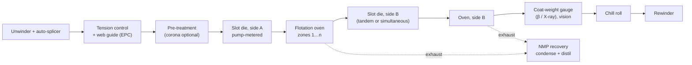

# Module 3 — Coating and Drying (Stages 3 and 4)

*Li-ion Cell Manufacturing: an Engineer's Course · Phase A · Evidence labels: [V] verified · [T] typical practice · [E] estimate · [P] proprietary*

**Bottom line:** coat weight (mg/cm²) is the single most important electrode characteristic — it sets capacity and the anode-to-cathode balance. The oven behind the coater is the largest energy user in the plant, and how fast you dry decides whether the binder stays where it is needed. Coating and drying are one machine and must be engineered together.

---

## 1. The concept in simple language

The slurry is pumped through a precision slot onto a moving foil, forming a wet film a few hundred microns thick. The foil then floats through a long oven where hot air evaporates the solvent, leaving a porous dry layer. Both sides of the foil are coated, either one after the other or at the same time.

## 2. Engineering principles

**Coat weight and balance.**
- Areal loading *m* (mg/cm²) × specific capacity (mAh/g) = areal capacity (mAh/cm²).
- The anode must carry slightly more capacity than the cathode it faces: the **N/P ratio** is usually ~1.05–1.20 **[T]**. Too low → lithium plating at the anode → safety risk. Too high → wasted anode and lower energy density.
- So coat-weight tolerance on *both* electrodes is a safety-relevant special characteristic, not just a capacity one.

**Slot-die physics.**
- A metering pump delivers a fixed volumetric flow *Q*. Wet thickness ≈ *Q* / (web speed × coating width). The die does not "meter"; the pump does.
- The **coating bead** (liquid bridge between die lips and web) must be stable. The *coating window* in speed–flow–gap space is bounded by air entrainment, ribbing, rivulets/streaks and bead break-up. Vacuum boxes behind the die extend the window at high speed.
- KIT demonstrated slot-die primer coating stable up to 500 m/min with a vacuum box and gaps of 105–250 µm — a lab result for thin primers, not a production speed for active layers **[V]** ([KIT, J. Coat. Technol. Res. 2024](https://publikationen.bibliothek.kit.edu/1000167973/152151672)).

**Drying physics.**
- Two phases: (1) **film shrinkage** at constant rate while solvent leaves the surface and particles pack together; (2) **pore emptying**, where capillary forces pull liquid (and dissolved/suspended binder) through pores.
- High drying rates in the shrinkage phase drag binder to the surface → **binder migration** → binder-depleted foil interface → poor adhesion and delamination; binder-rich top → higher resistance **[T]**.
- Thick water-based films crack from capillary stress when dried too fast **[T]**.
- Hence the classic **low–high–low** oven profile: gentle start, maximum heat once the film has consolidated, gentle finish **[T]**.

## 3. The industrial process

### 3.1 Coating methods

| Method | How it works | Pros | Cons | Use |
| --- | --- | --- | --- | --- |
| **Slot-die** | Pre-metered: pump flow through slot | Precise, closed system, high speed, sharp edges, intermittent possible | Die design, setup, sensitive to bead stability | Dominant in gigafactories **[T]** |
| **Comma (knife-over-roll)** | Excess slurry metered by gap between comma bar and roll | Simple, tolerant of viscosity | Lower precision and speed, open slurry pool (solvent loss, contamination) | Older lines, lab/pilot, some anodes **[T]** |
| Gravure / spray | — | Thin layers | Not for thick active layers | Primers, ceramic coatings on separators |

### 3.2 Continuous vs intermittent

- **Continuous:** stripes run the length of the roll with uncoated margins for tabs (used for winding with continuous tabs, and for laser-notched stacking electrodes).
- **Intermittent (skip) coating:** coating stops and starts to leave uncoated gaps along the length (some prismatic and pouch designs). Requires a fast-acting valve or shim actuator; start and stop edges ("head and tail") tend to be thick or thin and are a key quality topic **[T]**.

### 3.3 Single-side, tandem and simultaneous two-side coating

- **Tandem:** side A coated and dried, web turned, side B coated and dried — two ovens or one double-pass oven.
- **Simultaneous:** both sides coated almost at once and dried in a flotation oven (the web floats on air cushions with nothing touching the wet coating). Dürr lists its GigaCoater at 1,400 mm width, 40 m/min, 40–48 m flotation dryer, ~2 GWh/yr; GigaCoaterXL at 2,200 mm, 60 m/min, 50–70 m dryer, ~5 GWh/yr **[V]** ([Dürr](https://www.durr.com/fileadmin/durr.com/04_Company/01_Events/2019/duerr-advanced-battery-brochure.pdf)).

### 3.4 Drying and solvent recovery

- **Oven types:** convective air-flotation (most common), roll-support ovens, with infrared or laser assist on newer lines.
- **NMP recovery:** exhaust air is cooled to condense NMP, sometimes followed by adsorption or scrubbing, and the recovered NMP is purified by distillation and reused. Dürr states recovery rates typically above 99% **[V]**.
- **Water-based anode drying:** no recovery needed; still multi-zone for crack control.
- **Energy:** coating + drying including NMP recovery is reported at about 46% of production energy **[V]** ([EEPower on ORNL](https://eepower.com/market-insights/researchers-validate-benefits-of-dry-processing-in-lithium-ion-battery-manufacturing/)).

### 3.5 Dry electrode coating (emerging)

Solvent-free powder is fibrillated (PTFE), calendered into a film and laminated to foil. It removes the oven and NMP recovery entirely. Industrial maturity is still limited and process windows are largely proprietary **[P]**.

## 4. Equipment

| Unit | Function | Main components | Key parameters | Quality checkpoints | Common failures | Maintenance |
| --- | --- | --- | --- | --- | --- | --- |
| Unwinder + splicer | Feed foil without stopping | Shaft, auto-splice, dancer | Tension, splice timing | Splice position tracking (scrap length) | Wrinkles at splice | Bearing, pneumatic checks |
| Tension control | Constant web tension | Load cells, dancers, drives | Tension per zone (N) | Tension log | Foil breaks (thin Cu!) | Load-cell calibration |
| Web guide (EPC) | Lateral position | Edge sensor, steering frame | Edge position | Edge position SPC | Drift → edge misregistration | Sensor cleaning |
| Slot die | Lay down film | Die body, shims, lips, manifold | Gap, flow, die-to-web distance, vacuum box | Wet weight, edge profile | Lip damage (streaks), dried slurry at lips | Lip polishing, shim inspection |
| Slurry delivery | Constant flow | Buffer tank, gear or progressive-cavity pump, filters, degasser | Flow (mL/min), pressure, temperature | Pump speed vs coat weight | Pulsation (chatter marks), filter clogging | Pump wear check |
| Oven | Remove solvent | Zones, nozzles, fans, heaters, exhaust | Zone temperature, air velocity, exhaust flow, LEL monitoring | Residual solvent, cracks, adhesion | Uneven airflow (cross-web variation), nozzle blockage | Nozzle cleaning, balancing |
| Coat-weight gauge | Measure mg/cm² | β-ray or X-ray scanner, cross-web traverse | Accuracy, scan speed | Closed-loop to pump | Drift | Standard-foil calibration |
| Vision system | Surface defects | Line-scan cameras, lighting | Resolution | Defect map per meter | False calls | Lens cleaning |
| NMP recovery | Recover solvent | Condensers, cooling, distillation, scrubber/adsorber | Recovery %, NMP purity, emissions | Water content of recovered NMP | Fouling | Exchanger cleaning |
| Rewinder | Wind electrode roll | Shaft, lay-on roll | Taper tension | Roll hardness | Telescoping | — |

**Equipment suppliers [T]:** Hirano Tecseed and Toray Engineering (Japan, precision coaters), Dürr (Germany, coaters and NMP recovery), PNT and other Korean firms, Lead Intelligent and Yinghe (China). Korean suppliers hold about 40% of front-end electrode equipment sales among the top-25 suppliers, with PNT ranked second globally **[V]** ([Control Engineering](https://www.controleng.com/battery-equipment-market-shifts-open-new-competitive-paths/)).

## 5. Parameter table

| Parameter | Typical range | Purpose | Effect if off | Measurement | Control | Label |
| --- | --- | --- | --- | --- | --- | --- |
| Areal loading, EV energy cathode | ~15–30 mg/cm² per side (chemistry-specific) | Capacity | Capacity spread; N/P error → plating | β/X-ray gauge, punched-disc weighing | Pump closed loop | [T] |
| Areal capacity | ~2–4+ mAh/cm² (energy cells higher) | Cell design | — | Calculated | Design | [T] |
| N/P ratio | ~1.05–1.20 | Prevent plating | Plating / lost energy | Design + both gauges | Coordinated weight targets | [T] |
| Coat-weight tolerance | Often ±1–2% of target | Uniform capacity | Capacity spread, plating risk | Gauge | Closed loop | [T] / [P] |
| Wet film thickness | ~100–400 µm | — | — | Wet gauge / calculation | Flow | [T] |
| Line speed (production) | Tens of m/min (Dürr: 20–60 m/min by model) | Throughput | Too fast → bead instability, under-drying | Encoder | Drive | [V] Dürr |
| Web width | Up to ~1,400–2,200 mm on giga lines | Throughput | — | — | — | [V] Dürr |
| Oven length | Tens of metres (Dürr: 15–70 m by model) | Residence time | — | — | — | [V] Dürr |
| Zone temperatures (NMP) | Roughly 60–150 °C, low–high–low profile | Drying rate | Binder migration, cracks, residual solvent | Thermocouples, web-temperature pyrometer | Zone PID | [T] |
| Air velocity at nozzles | Recipe-specific | Heat/mass transfer | Cross-web non-uniformity | Anemometer survey | Fan speed | [P] |
| Residual NMP after drying | Low hundreds of ppm or below | Prevent side reactions | Gas, capacity loss | GC on samples | Oven profile | [T] |
| Edge build-up ("ear") | Minimised; spec per design | Calendering & winding | Edge cracks, wrinkles | Profile gauge | Shim design, edge-bead control | [T] |
| Adhesion (peel strength) | Spec per recipe | Integrity | Delamination | 90°/180° peel test | Binder, drying profile | [P] |
| NMP recovery rate | >99% | Cost, emissions | Cost, permit breach | Mass balance | Recovery system | [V] Dürr |

## 6. Coating and drying defects

| Defect | What it looks like | Root causes | Detection | Effect | Corrective / preventive |
| --- | --- | --- | --- | --- | --- |
| **Streaks** | Lines along the web | Agglomerates/particles stuck in die lip, damaged lips, dried slurry, unstable bead (low flow) | Vision, coat-weight cross profile | Local thin/thick, lithium plating at thin anode spots | Filter slurry, lip inspection & cleaning, adjust gap/flow/vacuum |
| **Pinholes / craters** | Small uncoated spots | Bubbles, contamination (oil, dust), poor wetting of foil | Vision, light table | Local plating, corrosion | Degassing, foil cleanliness (dyne), clean room discipline |
| **Cracking** | Mud-crack pattern | Too-fast drying, thick water-based films, low binder | Vision, microscopy | Particle loss, poor contact | Lower initial drying rate, binder/formulation |
| **Uneven coating (cross-web)** | Thickness profile not flat | Die manifold design, temperature differences, oven airflow | Gauge cross profile | Capacity spread | Die adjustment (flex lip), oven balancing |
| **Chatter / barring (along-web)** | Periodic thickness bands | Pump pulsation, roll eccentricity, vibration | Gauge frequency analysis | Capacity spread | Pulsation damping, bearing checks |
| **Edge defects** | Thick edge bead, wavy or ragged edge | Surface tension at edge, shim design | Profile gauge, vision | Calendering cracks, winding wrinkles, misalignment | Shim design, edge-bead management |
| **Head/tail defects (intermittent)** | Thick start, thin end | Valve dynamics | Gauge | Over/under capacity locally | Valve tuning |
| **Bubbles** | Blisters | Entrained air, solvent boiling (oven too hot early) | Vision | Pinholes | Degassing, oven profile |
| **Delamination** | Coating lifts from foil | Binder migration, foil oil/oxide, under-drying | Peel test, tape test | Capacity loss, particles | Drying profile, foil spec, binder |
| **Residual solvent** | — | Insufficient drying | GC | Gas, side reactions | Oven profile, speed |
| **Foil wrinkles / breaks** | — | Tension errors, thin Cu, heat | Web break detection | Downtime, scrap | Tension tuning, splice quality |

## 7. Factory example

A new anode coater shows cross-web coat weight 3% higher at the drive-side edge. Gauge data rule out the die. An oven airflow survey finds a nozzle header partly blocked by dried SBR residue on the drive side, so that edge dries slower and shows more binder migration and higher retained water — the gauge reads that as weight. **Fix:** clean the headers, add a quarterly nozzle airflow survey to the PM plan, and add cross-web profile Cpk to the daily quality meeting. Lesson: a gauge measures "mass per area", which includes solvent; always check residual solvent when a profile looks wrong.

## 8. Interview questions

1. Explain why the slot die does not set the coat weight. What does?
2. What is the N/P ratio and why is coat-weight tolerance on the anode a safety characteristic?
3. Describe binder migration and how oven zoning controls it.
4. How would you diagnose a periodic (along-web) coat-weight variation?
5. Simultaneous vs tandem two-side coating: trade-offs?
6. What would dry electrode coating remove from the plant, and what new risks does it bring?

## 9. Quiz

1. Name three things that bound the slot-die coating window.
2. Typical NMP recovery rate quoted by Dürr?
3. What profile is used across oven zones, and why?
4. What instrument measures coat weight inline?
5. Which defect is most associated with too-fast drying of thick water-based anodes?

Answers

1. Air entrainment, ribbing/streaks (low-flow limit), bead break-up (high speed); vacuum extends it.
2. Above 99% **[V]**.
3. Low–high–low: avoid binder migration early, maximise drying once consolidated, cool gently.
4. β-ray or X-ray scanning gauge.
5. Cracking.

## 10. Hands-on exercise

A 5 GWh/yr LFP line needs cathode output of *X* m² per hour. Using your cell design (choose: 300 Ah prismatic, cathode loading 25 mg/cm² per side, 160 mAh/g, 3.2 V, both sides coated, 90% overall material yield **[E]**), calculate (a) required coated area per year, (b) required line speed for a 1,400 mm web with 85% OEE, 7,500 h/yr, (c) how many coaters you need. Then compare with Dürr's 2–3 GWh per GigaCoater figure and explain any gap.

## Sources

- [Dürr — Advanced battery electrode brochure (coater sizes, speeds, NMP recovery)](https://www.durr.com/fileadmin/durr.com/04_Company/01_Events/2019/duerr-advanced-battery-brochure.pdf)
- [KIT — High-speed slot-die coating of electrode primers (2024)](https://publikationen.bibliothek.kit.edu/1000167973/152151672)
- [EEPower on ORNL dry-processing study](https://eepower.com/market-insights/researchers-validate-benefits-of-dry-processing-in-lithium-ion-battery-manufacturing/)
- [Zhang et al., electrode drying review (UCL preprint)](https://discovery.ucl.ac.uk/id/eprint/10139917/3/Shearing_Main%20article_As%20submitted_26.10.2021.pdf)
- [Control Engineering — battery equipment market shifts](https://www.controleng.com/battery-equipment-market-shifts-open-new-competitive-paths/)

**Next:** [Module 4 — Calendering](04-calendering.md)
