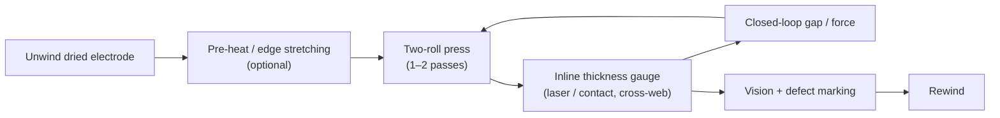

# Module 4 — Calendering (Stage 5)

*Li-ion Cell Manufacturing: an Engineer's Course · Phase A · Evidence labels: [V] verified · [T] typical practice · [E] estimate · [P] proprietary*

**Bottom line:** calendering trades porosity for energy density. Press too little and the electrode is thick and poorly connected; press too hard and you close the pores electrolyte needs, crack particles and wrinkle the foil. The target is a density (g/cm³) with a tight cross-web and along-web tolerance — exactly like a thickness tolerance on a rolled sheet, but with an electrochemical penalty for missing it.

---

## 1. The concept in simple language

The dried coating is fluffy (40–50% empty space). Two very stiff, very round rolls squeeze it to a target thickness, packing particles closer together so more active material fits in the same volume and the particles touch each other and the foil.

## 2. Engineering principle

**Porosity from density.**

```math
\varepsilon = 1 - \frac{\rho_{electrode}}{\rho_{true}}, \qquad
\frac{1}{\rho_{true}} = \sum_i \frac{w_i}{\rho_i}
```

where *w_i* are dry mass fractions and ρ_i the true densities of active material, carbon and binder.

*Worked example **[E]**:* NMC811 cathode, 96% CAM (4.75 g/cm³), 2% carbon (1.9 g/cm³), 2% PVDF (1.78 g/cm³). 1/ρ_true = 0.96/4.75 + 0.02/1.9 + 0.02/1.78 = 0.2021 + 0.0105 + 0.0112 = 0.2238 → ρ_true ≈ 4.47 g/cm³. At an electrode density of 3.4 g/cm³, ε ≈ 1 − 3.4/4.47 ≈ 24%.

**Trade-offs governed by porosity:**

| Lower porosity (more compression) | Higher porosity (less compression) |
| --- | --- |
| + Volumetric energy density | + Ionic transport (rate capability, fast charge) |
| + Particle-to-particle and particle-to-foil contact (electronic) | + Electrolyte wetting, faster filling |
| − Tortuosity ↑ → ionic resistance ↑ (Bruggeman: effective conductivity ∝ ε^1.5) **[T]** | − Weaker mechanical integrity, particle shedding |
| − Particle cracking, foil stretching, wetting time ↑ | − Lower energy density |

So energy cells run denser electrodes, power/fast-charge cells run more open ones.

**Mechanics.** The coating is compacted only where it is coated; the uncoated foil margin is not. The coated region elongates more than the bare edge, building stress at the boundary → wavy edges, wrinkles, even foil tears. Solutions: pre-stretch rolls for margins, heated rolls, reducing compaction steps, or uncoated-edge pressing **[T]**.

Roll deflection under load makes the gap larger in the middle; rolls are **crowned** or use bending compensation so cross-web thickness stays flat **[T]**.

## 3. The industrial process



Calenders are often integrated with slitting in one machine ("calendering-slitting integrated") on newer lines **[T]**. Some plants calender twice (rough + finish) for high-density targets.

## 4. Equipment

| Item | Detail |
| --- | --- |
| Working principle | Two hardened rolls (forged steel, hardness often >60 HRC), driven, with hydraulic force on chocks; gap or force control **[T]** |
| Main components | Work rolls (often 500–1,000+ mm diameter on production lines), hydraulic cylinders, gap sensors, roll heating (oil or induction), drives, unwind/rewind, tension control, thickness gauges, roll cleaning brushes and dust extraction **[T]** |
| Control modes | **Gap control** (constant gap; force varies with coating) or **force control** (constant line load; gap varies). Production usually uses gap control with force monitoring **[T]** |
| Widths | Dürr lists calendering widths 250–1,300 mm **[V]** |
| Key parameters | Line load (N/mm of width), roll gap, roll temperature, speed, tension, number of passes |
| Quality checkpoints | Thickness (cross and along web), density (by punched-disc mass ÷ volume), surface defects, edge waviness |
| Common failures | Roll surface damage (pits print through), bearing wear (thickness periodicity at roll circumference), hydraulic drift, heating non-uniformity |
| Maintenance | Roll regrinding schedule, bearing condition monitoring, gauge calibration, roll cleaning |
| Suppliers **[T]** | Saueressig (Matthews International), PNT and other Korean makers, Chinese makers including Yinghe and Lead Intelligent; Japanese precision press makers |

## 5. Parameter table

| Parameter | Typical range | Purpose | Effect if off | Measurement | Control | Label |
| --- | --- | --- | --- | --- | --- | --- |
| NMC cathode density | ~3.2–3.6 g/cm³ (porosity ~20–30%) | Energy density | Too high → poor rate, cracking; too low → low energy, weak contact | Disc mass ÷ thickness × area | Gap/force | [T] |
| LFP cathode density | ~2.2–2.6 g/cm³ | As above | As above | As above | As above | [T] |
| Graphite anode density | ~1.5–1.7 g/cm³ (porosity ~25–35%) | As above; anode porosity also governs plating risk in fast charge | Too dense → plating at high C-rate | As above | As above | [T] |
| Thickness reduction | ~20–40% of dry coating thickness | — | — | Gauge before/after | — | [T] |
| Thickness tolerance | Often ±2–3 µm per side on EV electrodes | Stack/jelly-roll fit, capacity | Can fit issues, capacity spread | Laser/contact gauge | Closed loop | [T]/[P] |
| Roll temperature | Ambient to ~120 °C (hot calendering) | Binder softening, easier densification, less springback | Too hot → binder smearing on rolls | RTD in roll / IR | Heating system | [T] |
| Line load | Hundreds to >1,000 N/mm | Achieve density | Too high → particle/foil damage | Load cells | Hydraulics | [T] |
| Speed | Similar to or above coating speed; tens to ~100 m/min | Throughput | Too fast → springback, defects | Encoder | Drive | [T] |
| Springback after calendering | A few % thickness recovery over hours | Final thickness | Over-thick electrode at assembly | Re-measure after rest | Over-compress allowance | [T] |
| Edge wave height | As low as possible; spec per design | Winding/stacking quality | Wrinkles, misalignment | Optical | Edge treatment | [P] |

## 6. Defects

| Defect | Root causes | Detection | Effect | Prevention / correction |
| --- | --- | --- | --- | --- |
| Foil wrinkles / wavy edges | Differential elongation coated vs uncoated, high line load | Vision, edge-wave sensor | Winding misalignment, tab cracks | Edge pre-stretching, multi-pass, heated rolls, design (narrower margins) |
| Foil breakage | Excess load, thin Cu foil, edge cracks from coating | Web break detector | Downtime, scrap | Load optimisation, edge quality upstream |
| Over-densification | Gap too small, coat-weight high spot | Density check | Poor rate, slow wetting, lithium plating (anode) | Closed-loop on thickness, coat-weight control |
| Under-densification | Gap too large, springback | Density check | Low energy, poor contact, particle shedding | Gap calibration |
| Particle cracking (NMC secondaries) | High load, low porosity target | SEM cross-section | Fresh surface → gas, fade | Limit density, single-crystal CAM |
| Periodic thickness variation | Roll eccentricity, bearing wear | FFT of gauge signal vs roll rotation | Capacity spread | Roll regrind, bearing replacement |
| Cross-web thickness variation | Roll deflection, temperature gradient | Cross-web gauge | Capacity spread, winding telescoping | Roll crown/bending, temperature uniformity |
| Roll marks / dents | Debris on rolls | Vision | Separator damage | Roll cleaning brushes, dust extraction |
| Binder smearing / sticking | Roll too hot, binder-rich surface | Visual | Defects, roll contamination | Temperature limits, upstream drying |
| Delamination | Coating adhesion poor, excessive shear at nip | Peel test | Particles, capacity loss | Adhesion upstream |

## 7. Factory example

After a CAM supplier switch to a single-crystal NMC, the same calender settings give 3.55 g/cm³ instead of 3.45 g/cm³, and cells show slower electrolyte wetting and lower 3C capacity. **Lesson:** density is a function of material as well as press settings; the calendering target belongs in the material change PPAP. Re-run the density–pressure curve (a "compaction curve") for every new material and update the control plan.

## 8. Interview questions

1. Derive porosity from electrode density and formulation.
2. Why do uncoated foil margins cause wrinkles during calendering, and how do you fix it?
3. Gap control or force control — which would you use in production and why?
4. How does anode porosity relate to fast-charge capability and lithium plating?
5. You see a thickness signal repeating every 2.5 m along the web. Where do you look?
6. What is springback, and how do you allow for it in the target?

## 9. Quiz

1. Typical density window for an NMC cathode?
2. Effective ionic conductivity in porous electrodes scales roughly as ε to what power (Bruggeman)?
3. Why are calender rolls crowned?
4. Name two benefits of hot calendering.
5. What measurement is used to check density offline?

<details><summary>Answers</summary>

1. ~3.2–3.6 g/cm³ **[T]**.
2. ~1.5.
3. To compensate roll deflection so the gap is uniform cross-web.
4. Easier densification at lower load, less springback (binder softens).
5. Punched disc: mass ÷ (area × thickness), minus foil.
</details>

## 10. Hands-on exercise

Using your formulation, build a spreadsheet that converts target porosity (20–35%) into target density and calendered thickness for a given coat weight. Plot thickness vs porosity (column chart of a few points). Then define the control plan line for calendered thickness: spec, gauge, frequency, Cpk target (≥1.67 for an SC), and reaction plan.

## Sources

- [Dürr — calendering widths](https://www.durr.com/fileadmin/durr.com/04_Company/01_Events/2019/duerr-advanced-battery-brochure.pdf)
- [Kwade et al., Nature Energy 2018](https://doi.org/10.1038/s41560-018-0130-3) (calendering–structure relationships; not opened this session)
- [PEM RWTH & VDMA guide, 5th ed.](https://battery-news.de/en/2026/02/12/pem-and-vdma-update-guide-to-battery-cell-production/)

**Next:** [Module 5 — Slitting, notching and cutting](05-slitting-notching-cutting.md)
