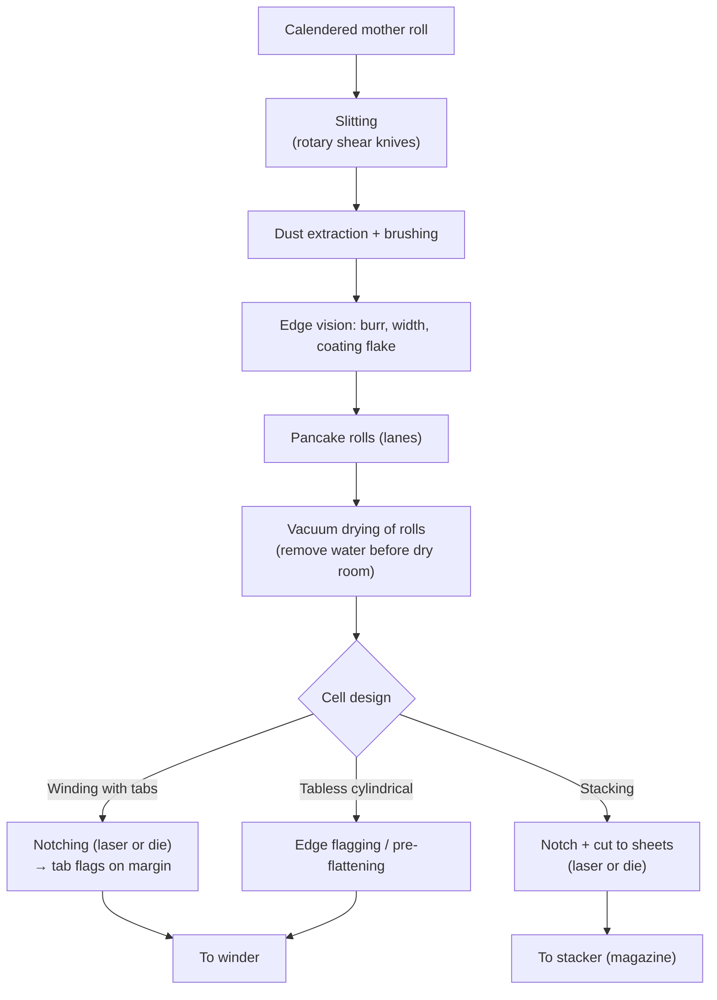

# Module 5 — Slitting, Notching and Cutting (Stage 6)

*Li-ion Cell Manufacturing: an Engineer's Course · Phase A · Evidence labels: [V] verified · [T] typical practice · [E] estimate · [P] proprietary*

**Bottom line:** this is where electrodes get their final geometry and where the most dangerous defect — a metal burr or loose particle that can pierce a separator — is created. Width and tab position decide whether assembly can hit its overhang tolerances. Burr height is a safety special characteristic.

---

## 1. The concept in simple language

The wide calendered "mother roll" is cut lengthwise into narrow strips (slitting). For many designs, the uncoated foil margin is then cut into tabs (notching), and for stacked cells each strip is cut into individual sheets (cutting). Every cut must be clean, dimensionally exact and free of loose dust.

## 2. Engineering principle

- **Shear cutting** of a brittle coating on a ductile foil: the coating fractures, the foil yields then separates. A worn or misaligned blade lets the foil deform before it separates → **burr** (raised edge) and **coating flaking** at the edge.
- **Laser cutting** ablates/melts the material: no tool wear, flexible geometry, but creates a **heat-affected zone (HAZ)**, molten droplets (spatter/"beads"), and coating retraction at the edge.
- **Safety logic:** separators are ~9–25 µm. A burr that is a meaningful fraction of that, pressed by stack pressure and swelling, can cut through → internal short. Burr limits are therefore set well below separator thickness **[T]**.
- **Geometry logic:** the anode must overhang the cathode on all sides (so no lithium plates at uncovered anode edges), and the separator must overhang the anode. Width tolerances and tab position stack up into these overhangs (Module 6).

## 3. The industrial process

**Slitting.** Pairs of circular top and bottom knives shear the web (shear slitting); knife overlap, side load, cant angle and sharpness determine edge quality **[T]**. Dürr quotes slitting up to 50 m/min with a lay-on roll **[V]** ([Dürr](https://www.durr.com/fileadmin/durr.com/04_Company/01_Events/2019/duerr-advanced-battery-brochure.pdf)).

**Vacuum drying.** Electrode rolls (or later, jelly rolls/stacks) are vacuum-dried at elevated temperature for hours to reduce absorbed water before entering the dry room or before filling **[T]**. Exact temperature/time/vacuum per material are recipe-specific **[P]**.

**Notching.**
- *Laser notching:* pulsed fibre lasers (ns, increasingly ps/fs for less HAZ) cut tab shapes from the moving web at high speed. Flexible (tab shape is software), no tool wear; risks are HAZ, spatter, and fumes **[T]**.
- *Mechanical die notching:* punch and die, very clean edges when sharp, high precision; but die wear (regrinding), changeover cost and speed limits **[T]**.

**Cutting to sheets (stacking designs).** Die or laser cut into individual electrodes, then delivered to stacker magazines. Some lines combine notching, cutting and stacking in one machine ("cut-and-stack").

## 4. Equipment

| Equipment | Working principle | Key parameters | Quality checkpoints | Common failures | Maintenance | Suppliers **[T]** |
| --- | --- | --- | --- | --- | --- | --- |
| Slitter (shear) | Rotary top/bottom knives | Knife overlap, side force, speed, tension, knife sharpness | Width, burr, edge flake, dust | Blade wear → burrs; knife misalignment | Blade change by length cut, alignment checks | Nishimura, Kampf, Yinghe, Lead Intelligent, Korean makers |
| Laser notcher | Pulsed laser ablation with scanner | Power, pulse width, frequency, scan speed, focus, assist gas, extraction | Burr, HAZ width, bead/spatter, tab dimension | Lens contamination, focus drift, extraction failure | Optics cleaning, power calibration | IPG, Trumpf, Coherent (sources); Hymson, Han's Laser, Lead Intelligent (machines) |
| Die notcher / cutter | Punch and die | Clearance, stroke speed, die sharpness | Burr, dimension | Die wear, chipping | Regrind schedule by strokes | Japanese and Korean precision die makers; Chinese makers |
| Vacuum dryer (rolls) | Heat + vacuum | Temperature, vacuum, time, N₂ backfill dew point | Moisture by KF | Leaks, uneven heating | Leak tests | Many |
| Dust extraction and brushes | Suction + brushing | Air velocity, brush condition | Particle counts | Clogged filters | Filter change | Many |
| Inline vision | Line-scan cameras | Resolution (few µm/px) | Burr, flakes, dimensions | False calls | Calibration | Keyence, Cognex, Basler-based integrators |

## 5. Parameter table

| Parameter | Typical range / spec | Purpose | Effect if off | Measurement | Control | Label |
| --- | --- | --- | --- | --- | --- | --- |
| Burr height | Well below separator thickness; often specified around ≤10 µm | Prevent separator puncture | Internal short | Microscope / laser profilometer on samples; inline vision | Blade/laser maintenance | [T] |
| Electrode width tolerance | Tenths of a mm or tighter for stacking | Overhang control | Overhang loss, plating, misalignment | Vision, caliper | Knife setup, EPC | [T] |
| Tab position / pitch | Tight; design-specific | Tab alignment after winding | Tab misalignment, weld failure | Vision | Encoder sync | [P] |
| HAZ width (laser) | Minimised; tens of µm-level | Edge integrity | Coating retraction, binder damage | Microscopy | Laser parameters | [T] |
| Spatter / beads | None loose; fused beads within spec | Prevent particles | Shorts | Vision, tape lift test | Extraction, parameters | [T] |
| Dust / loose particles | Per site particle spec | Prevent shorts | Self-discharge, shorts | Particle counts, tape test | Extraction, brushes | [T] |
| Knife life | Meters cut per regrind (track) | Burr control | Rising burrs | Burr trend | Preventive change | [P] |
| Electrode moisture after vacuum drying | Hundreds of ppm or lower | Reduce HF | Gas, fade | Karl Fischer | Drying recipe | [T]/[P] |

## 6. Defects

| Defect | Root causes | Detection | Effect | Prevention |
| --- | --- | --- | --- | --- |
| Burrs | Worn/misaligned knives, wrong overlap, die wear, laser beads | Vision, microscopy | Separator puncture, short | Tool life control, burr SPC, laser parameter windows |
| Coating flaking at edge | Poor adhesion, dull blades, HAZ | Vision, tape test | Particles → micro-shorts | Adhesion upstream, sharp tools |
| Dimensional error (width, tab) | Web wander, tension, encoder slip | Vision | Overhang loss, tab misalignment | EPC, tension control, encoder checks |
| Edge waviness / camber | Calendering stresses released | Visual | Winding telescoping | Calendering edge control |
| Tab cracks / folds | Handling, sharp corners in notch design | Vision | Weld failures, resistance | Tab radius design, guiding |
| Moisture pickup | Exposure time before drying | KF | HF, gas | Max exposure time, dry-room transfer |

## 7. Factory example

Weekly burr audits show a steady rise from 4 to 9 µm over 5 km of slit length on anode lanes, then a sudden jump to 14 µm. Root cause: a knife regrind interval set by calendar time rather than metres cut; a speed increase on the coater pushed more metres through per week. **Fix:** knife change by cumulative metres in the MES, burr SPC with a reaction limit at 8 µm, and inline vision for flake detection. The same logic as tool-life management on a press line.

## 8. Interview questions

1. Laser vs die notching: compare quality, cost, flexibility, and maintenance.
2. How would you set the burr specification and justify it?
3. What stacks up into anode overhang, and how does slitting contribute?
4. Why vacuum-dry electrodes before cell assembly, and how do you validate the recipe?
5. How do you control loose particles generated at this stage?

## 9. Quiz

1. What is a HAZ?
2. Why must the anode overhang the cathode?
3. Name two knife setup variables in shear slitting.
4. Which measurement method verifies moisture after vacuum drying?
5. What failure does a 15 µm burr risk with a 12 µm separator?

Answers

1. Heat-affected zone — material altered by laser heat near the cut.
2. To avoid lithium plating where cathode faces no anode.
3. Overlap, side force, cant angle (also sharpness, speed).
4. Karl Fischer titration.
5. Separator puncture → internal short.

## 10. Hands-on exercise

For a stacked pouch cell with cathode 200 × 100 mm, define anode and separator sizes and tolerances so that the anode overhangs the cathode by ≥1 mm and the separator overhangs the anode by ≥1 mm on every side **[E]**, including slitting/cutting tolerance, stacking placement tolerance and thermal shrinkage. Do a worst-case and an RSS tolerance stack-up, and decide which tolerances are SCs.

## Sources

- [Dürr — slitting speeds](https://www.durr.com/fileadmin/durr.com/04_Company/01_Events/2019/duerr-advanced-battery-brochure.pdf)
- [Comau dry-room lab (laser and mechanical notching development)](https://www.automotiveworld.com/?p=445379)
- [PEM RWTH & VDMA guide, 5th ed.](https://battery-news.de/en/2026/02/12/pem-and-vdma-update-guide-to-battery-cell-production/)

**Next:** [Module 6 — Cell assembly](06-cell-assembly.md)
