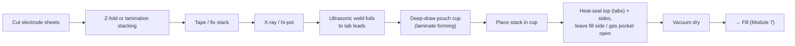

# Module 6 — Cell Assembly: Winding, Stacking, Welding, Housing (Stage 7)

*Li-ion Cell Manufacturing: an Engineer's Course · Phase B · Evidence labels: [V] verified · [T] typical practice · [E] estimate · [P] proprietary*

**Bottom line:** assembly turns continuous electrodes into discrete cells. Three things decide quality here — **alignment** (overhangs), **cleanliness** (no particles in the stack) and **joints** (tab welds). It is the most "automotive-like" part of the plant: high-speed automation, welding, vision, poka-yoke and takt time.

---

## 1. The concept in simple language

Cathode, separator, anode and separator are layered — either rolled up like a Swiss roll (winding) or laid flat like a deck of cards (stacking). The bare foil tabs of all cathode layers are welded together to the positive terminal, the anode tabs to the negative. The assembly goes into a can or pouch, which is closed except for a fill opening.

## 2. Engineering principles

**Overhang rules (the core design constraint).**
- Anode > cathode on every edge, so every cathode area faces anode (otherwise lithium plates on anode edges).
- Separator > anode on every edge, so electrodes never touch.
- Typical anode-over-cathode overhang is around 0.5–2 mm per side and separator-over-anode a similar order **[T]**; exact values are design IP **[P]**.
- Overhang is consumed by width tolerance (Module 5), placement/alignment tolerance, winding telescoping, and separator shrinkage.

**Winding vs stacking.**

| | Winding (jelly roll) | Stacking |
| --- | --- | --- |
| Motion | Continuous rotation | Discrete pick-place or Z-fold |
| Speed | Very high | Lower per layer; improving with multi-station and lamination stacking **[T]** |
| Space use in prismatic can | Rounded corners waste space; bending stress at fold radius | Flat layers fill the can; better volumetric efficiency |
| Stress | Inner-turn curvature stress, deformation on swelling | Uniform |
| Current path | Long electrode, tab positions matter (multi-tab or tabless improves) | Each layer has its own tab → low resistance |
| Typical | Cylindrical (all), many prismatic | Pouch, many large prismatic (e.g. blade-type) |

**Welding physics.**
- **Ultrasonic welding** (20–40 kHz **[T]**) joins stacks of thin foils (dozens of layers) by high-frequency scrubbing under pressure — solid-state, no melting, ideal for Al and Cu foil bundles.
- **Laser welding** (fibre lasers; green/blue wavelengths absorb better in copper) joins thicker parts: foil bundle to connector, connector to terminal, lid to can. Beam wobble reduces porosity and spatter **[T]**.
- **Resistance welding** joins cylindrical anode tab to can bottom through the jelly-roll core with an electrode rod **[T]**.

## 3. Process flows by format

### 3.1 Cylindrical (e.g. 18650, 21700, 46-series)

```mermaid
flowchart LR
    A["Cathode + anode strips<br/>+ 2 separators"] --> W["Winding on mandrel<br/>(tension, EPC)"]
    W --> TP["Tape end / pull mandrel"]
    TP --> IN["Insert insulators,<br/>jelly roll into can"]
    IN --> BW["Bottom weld<br/>(resistance or laser)"]
    BW --> BD["Beading / grooving"]
    BD --> HP["Hi-pot / short test"]
    HP --> DR["Vacuum dry"]
    DR --> FILL["→ Electrolyte fill (Module 7)"]
    FILL --> CAP["Cap weld + crimp seal"]
```

- **Tabbed design:** a single (or few) tab welded to the foil; the current travels along the whole electrode length.
- **Tabless / full-edge design (46-series):** the uncoated foil edge is flattened ("flagged" and pressed) and laser-welded to a current-collector disc at each end — much lower resistance and heat in large-diameter cells **[T]**.

### 3.2 Prismatic

```mermaid
flowchart LR
    E["Electrodes + separator"] --> WS["Flat winding or stacking"]
    WS --> HP1["Hot pressing (shape/flatten)"]
    HP1 --> XR["X-ray alignment check<br/>+ hi-pot"]
    XR --> US["Ultrasonic pre-weld<br/>of foil bundles"]
    US --> LW["Laser weld bundles<br/>to lid connectors"]
    LW --> INS["Insulation wrap (film)"]
    INS --> CI["Insert into Al can"]
    CI --> LS["Laser seal-weld lid to can"]
    LS --> LT["Leak test (He)"]
    LT --> VD["Vacuum dry"]
    VD --> FILL["→ Fill through port (Module 7)"]
```

Large prismatic cells often contain two or more jelly rolls/stacks in parallel in one can **[T]**.

### 3.3 Pouch

**Z-fold stacking:** a continuous separator zig-zags while cathode and anode sheets are inserted alternately into the folds. **Lamination stacking:** electrode and separator are heat-laminated into mono-cells or bi-cells first, then stacked — better alignment and handling at speed **[T]**.

## 4. Equipment

| Equipment | Principle | Main components | Key parameters | Quality checkpoints | Common failures | Suppliers **[T]** |
| --- | --- | --- | --- | --- | --- | --- |
| Winder (cylindrical / prismatic) | Electrodes and separators wound on mandrel under tension | Unwinds ×4, tension dancers, EPC, mandrel, cutters, taping, CCD | Tension per material, speed, EPC accuracy, mandrel geometry | Alignment (CCD), overhang, telescoping, roll diameter, hi-pot | Tension spikes → separator neck-down, misalignment, wrinkles | Lead Intelligent, Yinghe, CKD, Koem; Korean makers |
| Z-fold stacker | Separator zig-zag, electrode pick-place | Magazines, robots/grippers, vision, separator unwind | Cycle per layer, placement accuracy, separator tension | Per-layer vision, X-ray | Mis-picks (double sheets), static, particles | Lead Intelligent, Hymson, Geesun, Korean makers |
| Lamination stacker | Heat-laminate mono-cells then stack | Laminating rolls, cutters, stacking table | Lamination temp/pressure, accuracy | Peel strength, alignment | Delamination | Korean and Chinese makers |
| Hot press | Flatten/shape roll or stack | Heated platens | Temperature, pressure, time | Thickness | Separator damage if overheated | Many |
| Ultrasonic welder | 20–40 kHz vibration | Generator, converter, booster, horn, anvil | Energy, amplitude, pressure, time | Peel/pull test, weld-area vision | Horn wear, foil tearing, under-weld | Branson (Emerson), Schunk, Telsonic, Herrmann |
| Laser welder | Fibre (IR), green or blue laser | Source, scanner/wobble head, fixture, shielding gas | Power, speed, wobble, focus | Penetration (cross-section), porosity, spatter, leak test | Spatter → particles, porosity, cracks | Trumpf, IPG, Coherent; Han's Laser, Hymson, United Winners |
| Resistance welder | Current through contact | Power supply, electrodes | Current, time, force | Pull test | Electrode wear | Amada, Miyachi |
| X-ray / CT inspection | Transmission imaging | Source, detector, AI evaluation | Resolution | Anode overhang per layer, tab alignment, foreign particles | Throughput limits | Nikon, Zeiss, Comet Yxlon, Chinese makers |
| Hi-pot / insulation tester | Apply DC voltage across electrodes before filling | Tester, fixtures | Test voltage (hundreds of V), dwell, leakage limit | Insulation resistance | False passes (fixture contact) | Hioki, Chroma |
| Helium leak tester | Mass spectrometer detects He | Chamber, vacuum, MS | Leak rate limit | Weld integrity | Contamination | Inficon, Pfeiffer |

## 5. Parameter table

| Parameter | Typical range / spec | Purpose | Effect if off | Measurement | Control | Label |
| --- | --- | --- | --- | --- | --- | --- |
| Anode-over-cathode overhang | ~0.5–2 mm per side | Prevent plating | Plating at edges, safety | X-ray/CT, vision | Width tolerance + alignment | [T]/[P] |
| Separator-over-anode overhang | ~1–3 mm | Prevent contact | Short at edges | X-ray, vision | As above | [T]/[P] |
| Winding alignment (layer-to-layer) | Tenths of mm | Overhang | Telescoping, plating | CCD per turn | EPC | [T] |
| Winding tension | Recipe per material | Tight roll without stretch | Neck-down, wrinkles, loose roll | Load cells | Dancers | [P] |
| Ultrasonic weld energy/amplitude | Recipe per bundle | Joint strength, no foil tear | Weak or torn joints | Weld log, peel test | Generator closed loop | [P] |
| Laser weld penetration | Design-specific | Mechanical + electrical joint | Leak, high resistance | Cross-section (destructive), leak test | Power/speed | [P] |
| Hi-pot test voltage | Hundreds of volts DC | Detect shorts/particles before filling | Escapes → failures later | Insulation tester | Recipe | [T] |
| Insulation resistance | Megaohm range minimum | — | — | — | — | [T] |
| Can/lid seal leak rate | Very low (He leak test, mbar·L/s scale) | Hermeticity | Moisture ingress, leakage | He leak test | Laser weld control | [T] |
| Particles in dry room (assembly) | ISO class per site | Prevent shorts | Self-discharge | Particle counters | HVAC, gowning | [T] |

## 6. Defects

| Defect | Root cause | Detection | Effect | Prevention |
| --- | --- | --- | --- | --- |
| Misalignment / overhang loss | Web wander, width error, stacking placement error, telescoping | X-ray/CT, CCD | Plating, shorts | EPC, vision feedback, X-ray 100% on critical designs |
| Separator damage (holes, folds) | Burrs, particles, tension spikes, gripper damage | Hi-pot, visual | Short | Clean handling, tension control, gripper design |
| Foreign particle in stack | Dust, weld spatter, cutting debris | Hi-pot, X-ray, later OCV drop | Micro-short | Extraction at welding, dry-room cleanliness, spatter shields |
| Weak ultrasonic weld | Horn wear, contamination, wrong energy | Peel test (sample), weld monitoring | High resistance, open circuit | Horn PM, monitoring signatures |
| Torn foil at weld | Excess energy/amplitude | Vision | Particles, high resistance | Parameter window |
| Laser weld spatter / porosity | Contamination, wrong parameters, Cu reflectivity | Vision, leak test, cross-section | Particles, leaks | Wobble, green/blue lasers, cleaning |
| Lid weld leak | Gap, contamination, power drift | He leak test | Electrolyte leak, moisture ingress | Fixture gap control, monitoring |
| Pouch forming cracks | Over-deep draw, laminate defect | Visual, pinhole test | Leak | Draw-depth limits, laminate spec |
| Short (hi-pot fail) | Any of above | Hi-pot | Scrap (cheap now, expensive later) | 100% hi-pot before filling |

## 7. Factory example

A prismatic line has a 0.8% hi-pot failure rate, three times the target. Pareto by station and shift shows failures concentrated after the laser station that welds foil bundles to connectors on the night shift. Spatter shields are cleaned once per shift; at night, extraction filter differential pressure runs high (filter changed on day shift only). Particle counts inside the station rise in the last 3 hours of the night shift. **Fix:** extraction ΔP interlock, shield cleaning every 4 hours, and a particle-count trend on the station HMI. Classic process-capability problem with a maintenance root cause.

## 8. Interview questions

1. Compare winding and stacking for a 300 Ah prismatic LFP cell.
2. Why use ultrasonic welding for foil bundles and laser welding for terminals?
3. What does the hi-pot test detect, and why is it done before filling?
4. Explain tabless cylindrical design and why it matters for large-diameter cells.
5. How would you verify anode overhang in production, and what sampling would you use?
6. What causes telescoping in a jelly roll and how do you prevent it?

## 9. Quiz

1. What frequency range does ultrasonic welding use?
2. Which laser wavelengths absorb better in copper?
3. In Z-fold stacking, what is continuous: the separator or the electrodes?
4. Why are two or more jelly rolls often placed in one large prismatic can?
5. Name the inspection method used to measure overhang inside an assembled stack.

Answers

1. ~20–40 kHz **[T]**.
2. Green and blue.
3. The separator.
4. To limit roll thickness/size for process and thermal reasons while reaching high capacity.
5. X-ray / CT.

## 10. Hands-on exercise

Balance an assembly line for a 5 GWh/yr, 280 Ah, 3.2 V prismatic LFP cell (≈ 0.9 kWh per cell). (a) Compute cells per year and required takt time at 7,500 h/yr. (b) If a stacker builds one cell in 60 s **[E]** and a winder in 20 s **[E]**, how many machines do you need for each technology at 85% OEE? (c) Which downstream stations (ultrasonic welding, laser welding, lid sealing) become bottlenecks if their cycle is 15 s **[E]**? Draw the line with parallel stations.

## Sources

- [Control Engineering — equipment market by process step (Chinese suppliers 72% of top-25 assembly sales)](https://www.controleng.com/battery-equipment-market-shifts-open-new-competitive-paths/)
- [RWTH eLab pouch line (separation, deep drawing, Z-folding, ultrasonic welding, heat sealing, filling)](https://www.elab.rwth-aachen.de/en/?p=29)
- [PEM RWTH & VDMA guide, 5th ed.](https://battery-news.de/en/2026/02/12/pem-and-vdma-update-guide-to-battery-cell-production/)

**Next:** [Module 7 — Electrolyte filling and wetting](07-electrolyte-filling.md)
