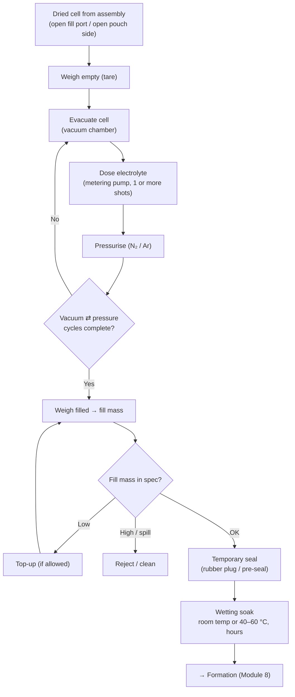

# Module 7 — Electrolyte Filling and Wetting (Stage 8)

*Li-ion Cell Manufacturing: an Engineer's Course · Phase B · Evidence labels: [V] verified · [T] typical practice · [E] estimate · [P] proprietary*

**Bottom line:** the cell is a sealed sponge of micro-pores; electrolyte must reach every pore before the first charge. Too little electrolyte or a dry spot means local lithium plating and short life; any moisture at this step becomes HF inside a sealed can. Filling is a dosing problem (mass accuracy) and a soaking problem (time, vacuum, temperature) in the driest room of the plant.

---

## 1. The concept in simple language

Pull a vacuum on the cell so the pores are empty, inject a precise mass of electrolyte, let pressure push it in, and wait — sometimes with repeated vacuum and pressure cycles — until the electrodes and separator are fully soaked. Then close the fill opening temporarily or permanently.

## 2. Engineering principle

- **Capillary penetration** into the electrode follows a Washburn-type behaviour: penetration depth grows with the square root of time and depends on pore size, contact angle and viscosity. Denser, thicker electrodes (Module 4) wet slower **[T]**.
- **Trapped gas** blocks pores; vacuum before dosing removes it, and pressure after dosing pushes liquid in. Cycling vacuum and pressure ("breathing") speeds wetting **[T]**.
- **Temperature** lowers viscosity and speeds wetting, but raises volatility and side reactions.
- **Fill amount** must fill all pore volume (electrodes + separator) plus a reserve consumed by SEI formation and ageing. It is often expressed as grams of electrolyte per Ah of capacity **[T]**; exact values are design IP **[P]**.
- **Water chemistry:** LiPF₆ + H₂O → LiF + POF₃ + 2 HF. This is why filling sits in the strictest dew-point zone and why electrolyte water spec is ~20 ppm **[T]**.

## 3. Electrolyte preparation and supply

| Item | Practice |
| --- | --- |
| Composition | ~1.0–1.2 M LiPF₆ in EC + linear carbonates (EMC/DMC/DEC) with additives (VC, FEC, LiDFOB, PS…) **[T]** |
| Where made | Usually bought pre-mixed from electrolyte makers; some large cell makers blend in-house **[T]** |
| Storage | Stainless drums/ISO containers under dry N₂ or Ar, temperature-controlled, shelf life tracked |
| Supply | Closed, inert-gas pressurised lines from storage to filling machines; filters; no air contact |
| Checks | Water (KF), free acid (HF titration), colour, conductivity, per lot and at point of use for drift |

## 4. The industrial process

### By format

| Format | Fill access | Closing after fill | Second fill? |
| --- | --- | --- | --- |
| Cylindrical | Open can top before cap | Cap placed and crimped (or welded) — final seal immediately | No |
| Prismatic | Fill port in lid | Temporary rubber/plug seal; final seal-pin welded after formation and degas | Often yes — top-up after formation **[T]** |
| Pouch | Open side with gas pocket | Pre-seal; final seal after degassing (Module 9) | Rarely |

### Wetting time

An industrial protocol cited by ORNL: electrode wetting 6–24 h at room temperature before the first formation cycles, a further 12–24 h after them, and electrolyte wetting 12–24 h at 40–60 °C; wetting plus formation took about 3–7 days in total **[V]** ([Wood, ORNL, NAATBatt 2019](https://assets-002.noviams.com/novi-file-uploads/naatbatt/Conference_Material/2019/W2-D_Wood_NAATBatt-2019-Presentation_Final.pdf)). Modern lines shorten this with pressure cycling and warm soaks; their exact recipes are proprietary **[P]**.

## 5. Equipment

| Equipment | Principle | Main components | Key parameters | Quality checkpoints | Common failures | Maintenance |
| --- | --- | --- | --- | --- | --- | --- |
| Filling machine (multi-station rotary or linear) | Vacuum + metered dosing + pressure | Vacuum chambers, dosing pumps (ceramic piston or gear), nozzles/needles, valves, inert-gas supply, load cells | Vacuum level and hold, shot volume, pressure, cycle count, temperature | Pre/post weights, fill mass Cpk | Nozzle drips/clogs (LiPF₆ crystallises), pump wear, vacuum leaks, seal wear | Nozzle cleaning, pump calibration (MSA on mass), leak checks |
| Checkweighers | Weigh before/after | Precision load cells in dry room | Resolution (0.01 g-level for large cells) | Gauge R&R | Drift with temperature, static | Daily calibration with standard weights |
| Soak / wetting chambers or racks | Hold at temperature (± pressure) | Heated racks, pressure vessels | Temperature, time, pressure | Time-temperature log per cell | Uneven heating | Temperature mapping |
| Electrolyte supply system | Closed inert-gas transfer | Drums/tanks, pumps, filters, piping, moisture sensors | Line pressure, water content | KF at point of use | Moisture ingress at connections | Leak tests, purging |
| Fume/solvent extraction | Local exhaust | Hoods, scrubbers | Air velocity | Area monitoring (HF, solvent) | Saturation | Filter change |

Typical suppliers **[T]**: filling machines from Chinese automation makers (Lead Intelligent, Yinghe and others) and Korean/Japanese specialists; pumps from precision-dosing makers.

## 6. Parameter table

| Parameter | Typical range / spec | Purpose | Effect if off | Measurement | Control | Label |
| --- | --- | --- | --- | --- | --- | --- |
| Fill mass | Design value (g); often ~1.3–2 g/Ah order depending on chemistry/porosity | Fill pores + reserve | Low → dry spots, fade; high → gas space loss, swelling, cost | Weigh before/after | Pump calibration, closed loop | [T]/[P] |
| Fill mass tolerance | Tight; often within about ±1% | Uniform cells | Capacity/life spread | Checkweigher, Cpk | — | [T] |
| Pre-fill vacuum | Deep vacuum (e.g. a few kPa absolute or lower) | Remove gas from pores | Slow/incomplete wetting | Vacuum gauge | Pump, leak tightness | [T] |
| Pressure step | Up to a few bar inert gas | Push electrolyte into pores | Slow wetting | Gauge | Valves | [T] |
| Vacuum–pressure cycles | Several | Wetting speed | Dry spots | Recipe log | PLC recipe | [P] |
| Soak temperature / time | RT or 40–60 °C; 6–24 h stages in a cited protocol | Complete wetting | Plating in formation | Rack logs | Recipe | [V] ORNL slide |
| Dew point in filling zone | Strictest zone (−40 to −60 °C class) | Prevent HF | Gas, fade | Dew-point sensors | HVAC | [T] |
| Electrolyte water at point of use | ~20 ppm order | HF control | Gas, fade | KF | Closed transfer | [T] |
| Time from vacuum drying to fill | Limited (hours) | Prevent moisture pickup | HF | MES timestamps | Max-time interlock | [P] |

## 7. Defects

| Defect | Root causes | Detection | Effect | Prevention / correction |
| --- | --- | --- | --- | --- |
| Under-fill | Pump wear, bubbles in supply, nozzle clog, leak | Post-fill weight | Dry spots, fade, plating | Pump PM, degassed supply, 100% weighing |
| Over-fill | Calibration error, double shot | Weight | Swelling, venting, cost | Interlocks |
| Spill / electrolyte on surface | Nozzle drip, splash during pressurisation | Visual, conductivity swab | Corrosion, poor seal (pouch), poor weld (seal pin) | Nozzle design, wipe/clean station, sealing area protection |
| Incomplete wetting | Short soak, dense electrodes, low temperature | Formation anomalies (high impedance, plating), EIS | Capacity loss, plating | Soak recipe validation (DOE), EIS check |
| Moisture contamination | Dew-point excursion, wet electrolyte, long exposure | KF, gas in formation | HF, gas, fade | Dew-point SPC, exposure-time interlocks |
| Leakage after fill | Bad temporary seal, damaged port | Weight loss, smell, sniff test | Moisture ingress | Seal maintenance |
| Contamination (particles) | Nozzle wear, dirty fixtures | Later OCV drop | Micro-short | Clean fixtures, filters |

## 8. Factory example

A prismatic line shows bimodal capacity at grading: a sub-population 1.5% low. Correlating MES data shows the low cells all came from filling station 7 of 12. Gauge R&R on that station's checkweigher is fine; but its dosing pump shows a slowly rising pressure ripple — a worn piston seal letting small gas pockets into the shot. Weight still passed because the low limit was set wide. **Fix:** tighten the fill-mass limit to a Cpk-based window, add per-station fill-mass SPC with run rules, and schedule pump seal replacement by cycle count. The data link from cell ID → station → parameters is why traceability (Module 14) matters.

## 9. Interview questions

1. Why is electrolyte filled under vacuum, and why cycle vacuum and pressure?
2. How do you set the fill mass for a new cell design?
3. Why do prismatic cells often get a second fill after formation?
4. How would you validate the wetting time?
5. What does LiPF₆ do with water, and what are the consequences inside the cell?
6. What data do you need to trace a capacity problem back to a filling station?

## 10. Quiz

1. Name three electrolyte components.
2. What closes a cylindrical cell after filling?
3. Which reaction makes moisture so damaging?
4. In the ORNL-cited industrial protocol, what temperature range is used for the warm electrolyte wetting step?
5. What is the main measurement for fill quantity?

Answers

1. LiPF₆ salt, EC + linear carbonates, additives.
2. Cap placement and crimp (or weld).
3. LiPF₆ + H₂O → HF (plus LiF, POF₃).
4. 40–60 °C **[V]**.
5. Weighing before and after (gravimetric).

## 11. Hands-on exercise

For your 280 Ah LFP prismatic cell, estimate the pore volume: cathode and anode porosity (from Module 4), electrode volumes, separator porosity (~40% **[T]**) and volume. Convert to electrolyte mass (density ~1.2 g/cm³ **[T]**), then add a reserve of 10–20% **[E]**. Compare your result in g/Ah with the [T] range above, and write the control-plan line for fill mass with a Cpk target.

## Sources

- [Wood, ORNL — formation and wetting (NAATBatt 2019)](https://assets-002.noviams.com/novi-file-uploads/naatbatt/Conference_Material/2019/W2-D_Wood_NAATBatt-2019-Presentation_Final.pdf)
- [Wood et al., Joule 2019 — formation challenges](https://doi.org/10.1016/j.joule.2019.11.018) (not opened this session)
- [PEM RWTH & VDMA guide, 5th ed.](https://battery-news.de/en/2026/02/12/pem-and-vdma-update-guide-to-battery-cell-production/)

**Next:** [Module 8 — Formation](08-formation.md)
