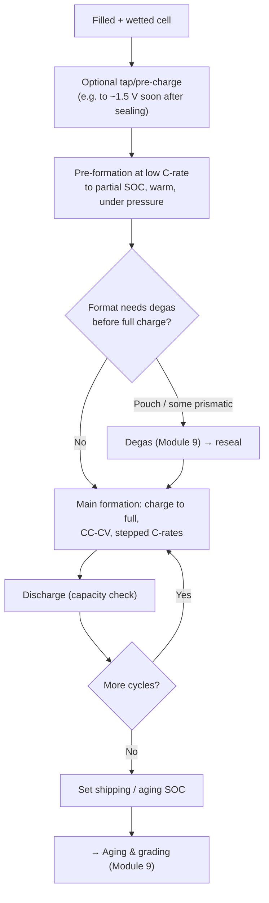

# Module 8 — Formation (Stage 9)

*Li-ion Cell Manufacturing: an Engineer's Course · Phase B · Evidence labels: [V] verified · [T] typical practice · [E] estimate · [P] proprietary*

**Bottom line:** formation is the first, carefully controlled charge that builds the solid electrolyte interphase (SEI) — a nanometre-thin film on the anode that decides the cell's cycle life, self-discharge and safety. It is slow, energy-hungry and occupies huge rack space, so it is both the cell's "birth" and the plant's capacity bottleneck. Every hour cut from formation without hurting the SEI is money.

---

## 1. The concept in simple language

A brand-new cell cannot be charged like a phone battery. The first lithium that moves into the graphite reacts with the electrolyte and forms a protective skin on the graphite. If that skin forms slowly and evenly, the cell lives long. If it forms fast and patchy, the cell loses lithium, makes gas and may plate metallic lithium. So the first charge is slow, warm, often under pressure, and fully monitored.

## 2. Engineering principle

- **SEI formation.** On first charge, the anode potential falls below the stability limit of the electrolyte (EC reduction starts around ~0.8 V vs Li/Li⁺ **[T]**). Solvent and additive molecules (VC, FEC) are reduced to an inorganic/organic film (Li₂CO₃, LiF, ROCO₂Li, polymers). Once formed, the SEI conducts Li⁺ but blocks electrons, stopping further reaction.
- **Irreversible capacity loss.** Lithium consumed in the SEI is lost for ever: first-cycle efficiency for graphite cells is typically ~85–95% **[T]**. That is why cathodes carry excess lithium relative to usable capacity and why silicon (higher loss) is hard.
- **CEI.** A thinner cathode–electrolyte interphase forms on high-voltage cathodes (NMC/NCA), more relevant at high Ni and high cut-off voltage **[T]**.
- **Gas.** SEI reactions release ethylene, CO, CO₂, H₂ **[T]**; pouch and many prismatic designs must remove it (Module 9).
- **Rate–quality trade-off.** Low current gives a dense, uniform SEI and avoids lithium plating while wetting is still incomplete; high current risks plating and a porous SEI. ORNL tests on NMC811 found 10-hour formations caused plating and worse retention, while 26–30-hour protocols performed best and longer gave no further gain **[V]** ([ORNL slides](https://assets-002.noviams.com/novi-file-uploads/naatbatt/Conference_Material/2019/W2-D_Wood_NAATBatt-2019-Presentation_Final.pdf)).
- **Temperature.** Warm formation (often ~35–45 °C **[T]**) improves kinetics and wetting; too hot accelerates side reactions.
- **Pressure.** Pouch and prismatic cells are often formed between pressure plates so gas does not create voids between layers and the stack stays in contact (hot-press formation) **[T]**.

## 3. Formation vs normal charging

| | Formation | Normal charging |
| --- | --- | --- |
| Purpose | Build SEI/CEI, activate cell | Store energy |
| Current | Low at start (e.g. ~0.02–0.2 C), stepped up **[T]** | 0.3–1C+ or fast charge |
| Voltage window | Staged; may stop at partial SOC for degassing | Full window |
| Temperature | Controlled, often elevated | Ambient/BMS-managed |
| Mechanical | Often under fixture pressure | Module/pack compression |
| Data | Every cell logged at high resolution; used for grading | BMS only |
| Repeat | Once (1–3 cycles) | Thousands of cycles |

## 4. The industrial process

Notes:

- **Tap charge:** ORNL's NMC811 test matrix applied a 1.5 V tap charge after vacuum sealing **[V]**. Purpose: get the anode potential away from the region where copper can dissolve during long rest periods **[T]**.
- An industrial protocol cited by ORNL: 1–2 formation cycles at 0.1–0.2C, then 1–2 cycles at 0.2–0.5C, with wetting steps in between; ~3–7 days including wetting **[V]**.
- **Faster formation research:** ORNL showed "shallow cycling" between 3.9–4.2 V for NMC532 cut formation time by at least 6× without hurting performance, and a high-SOC C/5 / low-SOC 1C scheme reached ~8.5× faster than baseline **[V]**. Industrial adoption is design-specific **[P]**.

## 5. Equipment

| Item | Detail |
| --- | --- |
| Formation cycler (charger/discharger) | Multi-channel bidirectional power electronics; each channel drives one cell (or series strings in some designs) with precise current and voltage. Modern units **recover discharge energy** back to the DC bus or grid **[T]** |
| Main components | Power modules, channel boards, contact probes/fixtures, temperature sensors per cell, rack chassis, DC bus, controller, data servers |
| Key specs | Current range, voltage accuracy (typically ~±0.02–0.05% of full scale class **[T]**), current accuracy, channel count, energy recovery efficiency, sampling rate |
| Formation racks / hot-press formation | Racks hold trays of cells; for pouch/prismatic, heated pressure plates (servo or pneumatic) apply defined pressure and temperature during formation **[T]** |
| Temperature control | Climate-controlled chambers or room; rack-level airflow; per-cell thermocouples |
| Data acquisition | V, I, T, capacity, energy, time per cell; uploaded to MES for grading and traceability; dQ/dV and impedance features for analytics |
| Safety | Cell-level voltage/temperature limits, smoke and gas detection, fire-rated compartments, rack-level fire suppression or flooding, automatic tray removal of abnormal cells **[T]** |
| Material handling | Automated stacker cranes and tray conveyors move trays between formation, aging and grading (Module 10) |
| Suppliers **[T]** | Hangke (Zhejiang Hangke), Lead Intelligent, Chroma ATE, Kataoka, PEC, Digatron, Bitrode; HYNN (cell finishing, partnering PEM RWTH **[V]**) |

Chinese suppliers hold about 70% of formation-and-testing equipment sales among the top-25 suppliers **[V]** ([Control Engineering](https://www.controleng.com/battery-equipment-market-shifts-open-new-competitive-paths/)).

## 6. Parameter table

| Parameter | Typical range | Purpose | Effect if off | Measurement | Control | Label |
| --- | --- | --- | --- | --- | --- | --- |
| Initial C-rate | ~0.02–0.2 C | Uniform SEI, avoid plating | Fast → plating, porous SEI | Cycler log | Recipe | [T] |
| Later C-rate | ~0.2–0.5 C | Finish formation faster | — | — | Recipe | [V] ORNL-cited protocol |
| Formation temperature | ~25–45 °C (often warm) | Kinetics, wetting | Hot → side reactions; cold → plating | Cell thermocouple | Chamber control | [T] |
| Upper cut-off voltage | Chemistry-specific (e.g. 3.65 V LFP, 4.2–4.3 V NMC class) | Full activation | Over-voltage → damage | Cycler | Recipe | [T] |
| CV termination current | e.g. C/20–C/50 | Complete charge | — | Cycler | Recipe | [T] |
| Fixture pressure (pouch/prismatic) | Design-specific | Layer contact, gas management | Voids, uneven SEI, plating | Load cell | Fixture | [P] |
| Rest/wetting times between steps | Hours | Wetting complete | Plating | MES timestamps | Recipe | [V] ORNL |
| Total formation time | Roughly 1–several days (excluding aging) | — | Cost vs quality | MES | Recipe | [V]/[T] |
| Cell voltage accuracy | High (sub-mV class) | Grading quality | Wrong grading | Calibration | MSA | [T] |
| First-cycle efficiency | ~85–95% (graphite) | Design check | Low → lithium loss, defects | Cycler data | — | [T] |

## 7. Defects and anomalies seen in formation

| Anomaly | Likely cause | Detection | Effect | Response |
| --- | --- | --- | --- | --- |
| Low first-charge capacity | Under-fill, incomplete wetting, low coat weight | Capacity vs model | Low-grade cell | Trace back to fill/coating data |
| Voltage plateau anomalies / "voltage dips" | Micro-short, particle | dV/dt, OCV during rest | Self-discharge, safety | Reject; analyse |
| Lithium plating | Too-high C-rate, cold, poor wetting, N/P too low locally | dQ/dV signatures, teardown (grey/silver deposits) | Capacity loss, dendrites | Lower C-rate early, warm, check wetting |
| Excessive gas / swelling | Moisture, residual NMP, wrong additive dose, high-Ni residual Li | Thickness, pressure sensors | Swelling, venting | Root cause upstream (KF, drying) |
| High temperature in a cell | Internal short | Per-cell T sensor | Thermal event risk | Isolate tray, safety system |
| Low first-cycle efficiency | High BET anode, moisture | Charge vs discharge capacity | Lost lithium | Material/process investigation |
| Contact faults | Dirty probes, misaligned trays | Contact resistance check | False rejects | Probe PM |

## 8. Formation process optimisation

1. **Design of experiments** on C-rate profile, temperature, pressure and SOC windows with cycle-life endpoints (accelerated tests) — the classic DOE you know from automotive, but with a 3–6 month response.
2. **Shallow cycling / high-SOC steps** to grow SEI faster without plating **[V]** (ORNL).
3. **Additive-tailored protocols** (e.g. hold at the reduction potential of VC/FEC).
4. **Energy recovery** cyclers to cut electricity cost.
5. **Use formation data for grading** so the separate grading step can be shortened or merged.
6. **Machine learning** on early formation curves to predict life and screen defects **[T]**.

## 9. Factory example

A ramping plant needs 20% more output without new racks. The team tests a shortened profile: higher C-rate in the second half of the first charge, 45 °C instead of 35 °C, and a merged capacity check. Accelerated cycle tests at 45 °C after 300 cycles show no retention loss versus control, and dQ/dV shows no plating signature. The change goes through a full PPAP-style change process: customer notification, re-validation, updated control plan. Net capacity gain: ~18% rack throughput **[E]**. The point: formation time is a design-and-validation decision, not a machine setting.

## 10. Interview questions

1. What is the SEI, how does it form, and why does it matter for life and safety?
2. Why is the first charge slow? What happens if you rush it?
3. Explain first-cycle efficiency and why cathodes are oversized in lithium.
4. Why do pouch cells form under pressure?
5. How would you shorten formation time, and how would you prove it is safe?
6. What data from formation do you feed into grading and traceability?
7. What is the purpose of a tap charge soon after sealing?

## 11. Quiz

1. Which electrolyte component is reduced first to form much of the SEI?
2. Name two gases released during formation.
3. What did ORNL find about 10-hour formation protocols for NMC811?
4. What share of formation/testing equipment sales do Chinese suppliers hold among the top 25?
5. What feature lets modern cyclers cut energy use?

Answers

1. Ethylene carbonate (EC), with additives such as VC/FEC.
2. Ethylene and CO₂ (also CO, H₂).
3. They caused lithium plating, faster impedance growth and the poorest long-term retention **[V]**.
4. About 70% **[V]**.
5. Energy recovery (regenerative discharge back to the bus/grid).

## 12. Hands-on exercise

Size the formation area for 5 GWh/yr of 280 Ah LFP prismatic cells (≈0.9 kWh each). Assume total formation occupancy of 24 h per cell **[E]**, channel availability 90% **[E]**, 7,800 h/yr. (a) How many channels do you need? (b) If a rack holds 256 channels, how many racks? (c) Repeat for 12 h and 48 h. (d) Estimate energy per year with 85% recovery efficiency vs no recovery. Plot channels vs formation time as a column chart.

## Sources

- [Wood, ORNL — formation protocols and fast formation (NAATBatt 2019)](https://assets-002.noviams.com/novi-file-uploads/naatbatt/Conference_Material/2019/W2-D_Wood_NAATBatt-2019-Presentation_Final.pdf)
- [Battery-News — PEM on formation as a time- and energy-intensive step (HYNN partnership)](https://battery-news.de/?p=26488)
- [Control Engineering — formation/testing equipment market](https://www.controleng.com/battery-equipment-market-shifts-open-new-competitive-paths/)
- [Wood et al., Joule 2019](https://doi.org/10.1016/j.joule.2019.11.018) (not opened this session)

**Next:** [Module 9 — Degassing, aging, grading and final test](09-degassing-aging-grading-final-test.md)
