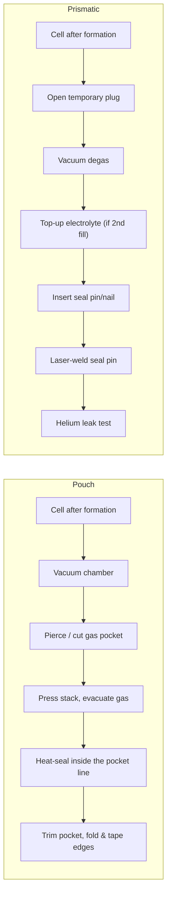
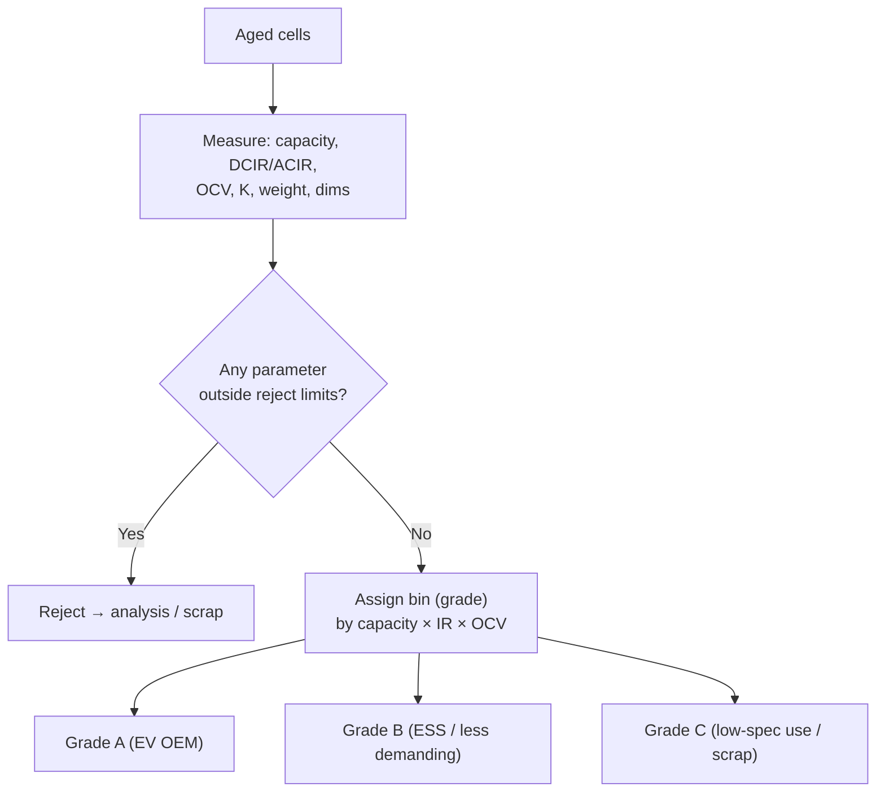

# Module 9 — Degassing, Final Sealing, Aging, Grading and Final Test (Stages 10–12)

*Li-ion Cell Manufacturing: an Engineer's Course · Phase B · Evidence labels: [V] verified · [T] typical practice · [E] estimate · [P] proprietary*

**Bottom line:** after formation the cell is electrochemically alive but not yet trustworthy. Degassing and final sealing make it hermetic; aging gives hidden defects time to reveal themselves through voltage drift; grading sorts good cells into matched bins; final test and traceability release them to pack lines. This is your end-of-line (EOL) and audit area — the last chance before a defect reaches a customer.

---

## Part A — Degassing and final sealing (Stage 10)

### A1. Concept

Formation produced gas. In a pouch, the gas sits in a sacrificial "gas pocket"; in a prismatic can, it sits in the headspace under the fill port. It must be removed and the cell closed permanently. Cylindrical cells are already sealed; their gas stays in the headspace and the vent/CID design accounts for it.

### A2. Process flows

### A3. Parameters

| Parameter | Typical range / spec | Purpose | Effect if off | Measurement | Label |
| --- | --- | --- | --- | --- | --- |
| Degas vacuum level and hold time | Deep vacuum, seconds to minutes | Remove gas | Residual gas → swelling, poor contact | Gauge | [T] |
| Electrolyte lost during degas | Minimised, measured by weight | Keep fill mass | Under-fill | Weight before/after | [T] |
| Pouch heat-seal temperature | Typically ~170–210 °C class | Melt CPP layer to fuse | Low → weak seal; high → burn-through, thinning | Thermocouple on bars | [T] |
| Pouch seal time / pressure | Seconds; MPa-level pressure | Seal integrity | Channels, wrinkles | Recipe log | [T] |
| Seal width | Several mm | Moisture barrier path | Short path → moisture ingress over life | Vision | [P] |
| Seal-pin laser weld | Power/speed per design | Hermetic close | Leak, spatter | Leak test, vision | [P] |
| He leak rate (prismatic) | Very low, mbar·L/s order specified per design | Hermeticity | Moisture ingress, electrolyte loss | He mass spectrometer | [T] |

### A4. Defects

| Defect | Cause | Detection | Prevention |
| --- | --- | --- | --- |
| Seal channel / leak (pouch) | Electrolyte or particles in seal zone, wrinkles, low temperature | Peel test (sample), burst/vacuum decay test, visual | Keep seal area clean during fill/degas; bar parallelism checks |
| Over-thinned seal (pouch) | Excess temperature/pressure | Cross-section, thickness | Recipe window, bar flatness |
| Residual gas / swelling | Short degas, more gas after degas | Thickness measurement | Degas recipe; root cause of gas |
| Seal-pin weld porosity | Electrolyte residue on port | Leak test, vision | Port cleaning before weld |
| Electrolyte creep on surface | Spill during degas | Visual, swab | Wipe station |

---

## Part B — Aging (Stage 11a)

### B1. Concept and principle

Store the cell for days at controlled temperature and watch its open-circuit voltage (OCV). A healthy cell's OCV drifts only slightly as the SEI stabilises. A cell with a **micro-short** (a particle or burr bridging electrodes through the separator, or metal dendrites) leaks current internally and its OCV drops faster.

- **High-temperature aging** (often ~40–60 °C for hours to a few days **[T]**) speeds up SEI stabilisation and makes defects show sooner.
- **Room-temperature aging** (often 7–21 days **[T]**) then gives the measurement period.
- **K-value:** K = (OCV₁ − OCV₂) / (t₂ − t₁), usually in mV/day. Cells above a limit are rejected **[T]**.
- **Statistical limits:** because OCV drift depends on SOC, temperature and lot, many plants use **dynamic limits** — e.g. lot mean + n·σ — instead of a single fixed number **[T]**. This is a direct application of SPC thinking: you are looking for outliers from the lot's own distribution.

### B2. Why LFP is harder

LFP's voltage curve is very flat over mid-SOC, so a small charge loss changes OCV very little. Plants therefore age LFP at an SOC where the curve has slope, use longer aging, use higher-resolution voltmeters (µV class), and control temperature tightly **[T]**.

### B3. Equipment

| Item | Detail |
| --- | --- |
| Aging racks / high-bay storage | Automated storage and retrieval (stacker cranes) holding trays for days–weeks; temperature-controlled zones; fire detection and suppression **[T]** |
| OCV/ACIR testers | Precision DMM + 1 kHz AC-impedance meter with multi-probe fixtures; µV-level resolution for LFP **[T]** (e.g. Hioki, Keysight, Chroma) |
| Temperature compensation | Measure cell temperature at OCV reading; correct OCV for temperature |
| Data | Each reading logged to cell ID in MES; K-value computed automatically |

### B4. Parameters

| Parameter | Typical range | Purpose | Label |
| --- | --- | --- | --- |
| High-temp aging | ~40–60 °C, hours–days | Stabilise SEI, accelerate defect appearance | [T] |
| RT aging duration | ~7–21 days | Measure self-discharge | [T] |
| SOC during aging | Chemistry-specific (where OCV-SOC slope is useful) | Sensitivity | [T]/[P] |
| K-value limit | Fixed (mV/day) or dynamic (mean + nσ) | Screen micro-shorts | [T]/[P] |
| OCV measurement resolution | Sub-mV; µV class for LFP | Detect small drift | [T] |
| Temperature control during aging | Tight (± 1–2 °C class) | OCV comparability | [T] |

---

## Part C — Grading (Stage 11b)

### C1. What is measured

| Measurement | How | Why |
| --- | --- | --- |
| **Capacity** | Full charge (CC-CV) and discharge at a standard C-rate and temperature on cyclers | Bin by Ah; rated capacity guarantee |
| **DCIR** | Current pulse (e.g. seconds-long) at defined SOC and temperature; ΔV/ΔI | Power capability, heat generation |
| **ACIR** | 1 kHz AC impedance | Fast, non-invasive; ohmic resistance (tabs, welds, electrolyte) |
| **OCV** | Precision voltmeter at defined SOC | Matching, self-discharge |
| **Self-discharge (K)** | From aging | Defect screen |
| **Weight** | Checkweigher | Fill mass / missing parts check |
| **Dimensions / thickness** | Laser/contact gauges, flatness | Fits module; swelling check |
| **Insulation (shell-to-terminal)** | DC insulation tester | Prismatic shell isolation |

### C2. How grading works

- **Grades** are commercial categories: e.g. Grade A cells meet full spec with tight bins for OEM packs; lower grades go to less demanding uses at a discount **[T]**. Exact grade rules are customer- and company-specific **[P]**.
- **Bins / cell matching:** within a grade, cells are binned (e.g. narrow capacity and resistance windows) so that series-connected cells in a module age similarly; unmatched cells drift apart and the BMS must balance more **[T]**.
- **Using formation data:** many plants compute capacity from formation discharge to shorten or skip a separate capacity cycle **[T]**.

---

## Part D — Final test, traceability, packaging and release (Stage 12)

| Step | Detail |
| --- | --- |
| Final electrical | OCV and ACIR re-check (catches anything since grading), insulation resistance (prismatic: terminal-to-can), polarity |
| Leak test | He leak (prismatic), vacuum decay or sniffing (pouch) on sample or 100% depending on design |
| Visual | Automated vision: dents, scratches, swelling, electrolyte residue, label/code quality, terminal condition |
| Dimensions & weight | 100% for module-fit characteristics |
| Traceability | Laser-marked QR/DataMatrix code links to full genealogy: material lots, mixer batch, coater lane/position, calender, slitter, assembly station, fill mass, formation curve, aging data, grade |
| Labelling | Cell ID, grade/bin, date; customer-specific |
| SOC for shipping | Set storage SOC; for air shipment of cells alone (UN3480), IATA requires ≤30% SOC **[T — check current IATA edition]** |
| Packaging | Insulating trays/blisters, terminal protection, cartons rated for dangerous goods (Class 9) |
| Storage | Fire-protected finished-goods warehouse, temperature-controlled, FIFO |
| Release | Lot release with data package; certificate of conformity; type-approval tests done separately (e.g. UN 38.3 transport tests **[T]**, customer validation, Indian BIS requirements where applicable — verify for your product) |

## Part E — Defects caught at stages 10–12

| Defect | Signature | Root cause (typical) | Response |
| --- | --- | --- | --- |
| Micro-short | High K-value, OCV drop | Particle, burr, separator damage, metallic contamination | Reject; tear-down sampling; trace back by genealogy |
| Low capacity | Below bin | Coat weight low, under-fill, plating in formation, lithium loss | Trace via MES to stage |
| High DCIR/ACIR | Above limit | Weak tab weld, low electrolyte, poor wetting, over-densified electrode | Trace to welding/filling |
| Leak | Weight loss, He leak fail, smell | Seal/weld defect | Containment by station/lot |
| Swelling | Thickness out | Gas, moisture | Upstream moisture control |
| Insulation fail | Low IR shell-terminal | Damaged insulation film, electrolyte residue | Assembly/cleaning |

## Factory example

A customer reports two cells in a module with OCV 40 mV below neighbours after 3 months in storage. Genealogy shows both from the same slitting lane on the same day; aging data show K-values just inside the fixed limit, but far outside the lot's mean + 4σ. **Actions:** switch to dynamic K limits; quarantine all cells from that lane-day with K above mean + 3σ; tear-down finds edge burrs. **Learning:** fixed reject limits hide outliers within good-looking lots; use SPC logic on EOL data.

## Interview questions

1. Explain K-value testing and why dynamic limits are better than fixed ones.
2. Why is self-discharge screening harder for LFP than NMC?
3. ACIR vs DCIR — what does each tell you?
4. Describe pouch degassing and the main sealing failure modes.
5. How do grades and bins differ? Why does a pack maker care about bins?
6. What would you include in a cell's traceability record?

## Quiz

1. Which format does not need a separate degassing step?
2. What frequency is used for ACIR?
3. Typical room-temperature aging duration?
4. What does a seal pin close on a prismatic cell?
5. Why measure cell temperature when reading OCV?

Answers

1. Cylindrical.
2. 1 kHz.
3. ~7–21 days **[T]**.
4. The electrolyte fill port.
5. OCV depends on temperature; readings must be compensated to compare cells.

## Hands-on exercise

Take 200 simulated cells: generate OCV drops with mean 0.5 mV/day and σ 0.08 mV/day, plus 3 defective cells at 1.1, 0.95 and 0.8 mV/day **[E]**. (a) Apply a fixed limit of 1.0 mV/day: what escapes? (b) Apply mean + 4σ computed on the lot: what is caught? (c) Write the control plan line for K-value screening, including reaction plan for a lot with an abnormal reject rate.

## Sources

- [PEM RWTH & VDMA guide, 5th ed.](https://battery-news.de/en/2026/02/12/pem-and-vdma-update-guide-to-battery-cell-production/)
- [Battery-News — PEM on cell finishing challenges](https://battery-news.de/?p=26488)
- [Electrive — PEM model for configuring cell finishing; notes cell-specific equipment, long process times and high energy demand (German)](https://www.electrive.net/2025/10/08/pem-zeigt-virtuelles-modell-zur-optimierung-der-batteriezellfertigung/)

**Next:** [Module 10 — Equipment and line integration](10-equipment-and-line-integration.md)
