# Module 10 — Equipment List and Line Integration

*Li-ion Cell Manufacturing: an Engineer's Course · Phase C · Evidence labels: [V] verified · [T] typical practice · [E] estimate · [P] proprietary*

**Bottom line:** a cell plant is three different factories joined by buffers: a **continuous web plant** (mixing → slitting), a **discrete high-speed assembly plant** (winding/stacking → filling), and a **warehouse that charges things** (formation → grading). Integration is about sizing each block to the plant capacity, decoupling them with buffers, and wiring every machine into one MES so each cell carries its genealogy.

**On suppliers:** global names are widely reported players **[T]**; check current product lines before an RFQ. Indian suppliers for core cell-process machines are still scarce; the Indian base today is mainly utilities (dehumidification, HVAC, chillers), material handling, integration and civil/MEP **[T]**.

---

## 1. Line architecture

```mermaid
flowchart LR
    subgraph EL["Electrode block (continuous, roll-based)"]
      M["Mixing ×n"] --> C["Coater + oven ×n"]
      C --> CA["Calender ×n"]
      CA --> SL["Slitter ×n"]
    end
    SL --> RB[("Roll buffer /<br/>vacuum dryers")]
    subgraph AS["Assembly block (discrete, high speed, dry room)"]
      RB --> NW["Notch + wind/stack ×n"]
      NW --> WE["Weld + case + seal ×n"]
      WE --> FI["Fill ×n"]
    end
    FI --> TB[("Tray buffer /<br/>wetting racks")]
    subgraph FN["Finishing block (tray-based, long dwell)"]
      TB --> FO["Formation racks ×many"]
      FO --> DG["Degas / seal-pin"]
      DG --> AGE[("Aging high-bay")]
      AGE --> GR["Grading + EOL"]
    end
    GR --> FG[("Finished-goods store")]
```

Rules of thumb **[T]**:
- Electrode block runs in **rolls**; assembly in **cells per minute**; finishing in **trays × hours/days**. Buffers absorb the mismatch and protect the bottleneck.
- Cathode and anode electrode lines are physically separated (avoid cross-contamination — especially copper/graphite into cathode).
- One mixer/coater/calender set is usually shared across several assembly lines; formation and aging scale with cell count × dwell time.

## 2. Equipment cards

Each card follows the template you asked for. Capacities and cycle times are **[T]/[E]** guides — confirm with OEM quotes.

### 2.1 Powder handling systems

| Parameter | Details |
| --- | --- |
| Stage | 1 |
| Working principle | Contained big-bag discharge, vacuum or dense-phase pneumatic conveying to day silos, gravimetric loss-in-weight dosing |
| Main components | Unloading stations, conveying lines, filters, silos, magnets, sieves, feeders, dry-air/N₂ supply |
| Key parameters | Conveying velocity, gas dew point, dosing accuracy |
| Production capacity | Tonnes/hour, sized to mixer demand |
| Cycle time | Continuous / batch refills |
| Automation | High (recipe-driven from MES) |
| Quality checkpoints | Dosing weights, magnet catch logs, moisture |
| Common failures | Blockages, filter blinding, attrition of NMC secondaries, cross-contamination |
| Maintenance | Filter change, wear-part inspection, magnet cleaning, feeder calibration |
| Global makers **[T]** | Coperion (K-Tron), Schenck Process, Hosokawa, Chinese integrators |
| India **[T]** | Indian bulk-handling integrators exist for chemicals/pharma; battery-grade contamination control is the gap |

### 2.2 Mixing systems

| Parameter | Details |
| --- | --- |
| Stage | 2 |
| Working principle | Batch double-planetary + disperser, or continuous twin-screw extrusion |
| Main components | Jacketed bowl/barrel, blades/screws, vacuum, binder tanks, buffer tanks, filters |
| Key parameters | Speed, specific energy, temperature, vacuum, sequence |
| Capacity | Planetary 2–1,500 L batches; continuous 20–2,000 kg/h **[V]** ([Dürr](https://www.durr.com/fileadmin/durr.com/04_Company/01_Events/2019/duerr-advanced-battery-brochure.pdf)) |
| Cycle time | Hours per batch (planetary) **[T]** |
| Automation | High; recipe-locked |
| Quality checkpoints | Viscosity, solids, grind, density |
| Common failures | Seal leaks, blade wear, temperature drift |
| Maintenance | Seals, wear coating inspection, cleaning between recipes |
| Global makers **[T]** | Bühler, Coperion, Dürr, Inoue, PRIMIX, Ross; Chinese makers |
| India | Imported **[T]** |

### 2.3 Coating machines and 2.4 drying ovens

| Parameter | Details |
| --- | --- |
| Stage | 3–4 |
| Working principle | Pump-metered slot-die coating; air-flotation convective drying; NMP condensation + distillation |
| Main components | Unwind/splice, tension, EPC, slot dies, pumps, ovens, gauges, vision, chill, rewind, NMP recovery |
| Key parameters | Coat weight, speed, zone temperatures, air velocity, residual solvent |
| Capacity | GigaCoater 1,400 mm/40 m/min ≈ 2 GWh/yr; XL 2,200 mm/60 m/min ≈ 5 GWh/yr **[V]** (Dürr) |
| Cycle time | Continuous |
| Automation | High; closed-loop coat weight |
| Quality checkpoints | Coat-weight profile, defects map, adhesion, residual solvent |
| Common failures | Lip damage, pump pulsation, nozzle blockage, web breaks |
| Maintenance | Die cleaning, oven nozzle cleaning, gauge calibration, NMP system cleaning |
| Global makers **[T]** | Hirano Tecseed, Toray Engineering, Dürr, PNT, Lead Intelligent, Yinghe |
| India | Imported **[T]** |

### 2.5 Calendering machines

| Parameter | Details |
| --- | --- |
| Stage | 5 |
| Working principle | Hydraulic two-roll press with gap/force control, heated rolls |
| Main components | Rolls, chocks, cylinders, heaters, gauges, unwind/rewind |
| Key parameters | Line load, gap, temperature, speed |
| Capacity | Matched to coater output; widths 250–1,300 mm **[V]** (Dürr) |
| Automation | High |
| Quality checkpoints | Thickness, density, edge wave |
| Common failures | Roll damage, bearing wear, hydraulic drift |
| Maintenance | Roll regrinding, bearing monitoring |
| Global makers **[T]** | Saueressig (Matthews), PNT, Lead Intelligent, Yinghe |
| India | Imported **[T]** |

### 2.6 Slitting machines and 2.7 laser cutting / notching

| Parameter | Slitter | Laser notcher/cutter |
| --- | --- | --- |
| Stage | 6 | 6 |
| Principle | Rotary shear knives | Pulsed laser ablation with galvo scanner |
| Components | Knife shafts, tension, EPC, extraction, vision | Laser source, scanner, web handling, extraction, vision |
| Key parameters | Overlap, side force, speed | Power, pulse, speed, focus |
| Capacity | Up to ~50 m/min slitting **[V]** (Dürr) | High web speeds; machine-specific **[T]** |
| Quality | Width, burr, flakes | Burr, HAZ, beads, tab dimension |
| Failures | Blade wear | Optics contamination, focus drift |
| Maintenance | Blade change by metres | Optics cleaning, power check |
| Makers **[T]** | Nishimura, Kampf, Lead, Yinghe | Lead, Hymson, Han's Laser, Manz; sources IPG, Trumpf, Coherent |
| India | Imported **[T]** | Imported **[T]** |

### 2.8 Winding machines and 2.9 stacking machines

| Parameter | Winder | Stacker |
| --- | --- | --- |
| Stage | 7 | 7 |
| Principle | Continuous rotation on mandrel | Z-fold, cut-and-stack or lamination-stack |
| Components | 4 unwinds, dancers, EPC, mandrel, CCD | Magazines, robots, separator unwind, vision |
| Key parameters | Tension, speed, alignment | Placement accuracy, time per layer |
| Capacity | Cylindrical: many cells/min per machine; prismatic: seconds–tens of seconds per roll **[T]** | Tens of seconds to minutes per large cell **[T]** |
| Quality | CCD alignment, hi-pot | Per-layer vision, X-ray |
| Failures | Tension spikes, telescoping | Double pick, static, particles |
| Maintenance | Dancer/bearing checks | Gripper wear, vacuum cups |
| Makers **[T]** | Lead, Yinghe, CKD, Koem | Lead, Hymson, Geesun, Korean makers |
| India | Imported **[T]** | Imported **[T]** |

### 2.10 Welding machines

| Parameter | Details |
| --- | --- |
| Stage | 7 (and 10 for seal pins) |
| Principle | Ultrasonic (foil bundles), laser (terminals, lids, tabless discs, seal pins), resistance (cylindrical bottoms) |
| Key parameters | Energy/amplitude/pressure (US); power/speed/wobble (laser) |
| Capacity | Seconds per weld **[T]** |
| Quality | Weld signatures, pull/peel, leak, cross-section |
| Failures | Horn wear, spatter, porosity |
| Maintenance | Horn/anvil change, optics |
| Makers **[T]** | Branson/Emerson, Schunk, Telsonic, Herrmann (US); Trumpf, IPG, Coherent, Han's, United Winners (laser); Amada (resistance) |
| India **[T]** | Laser and US welding integrators exist (pack lines); cell-grade sealing lines imported |

### 2.11 Electrolyte filling machines

| Parameter | Details |
| --- | --- |
| Stage | 8 |
| Principle | Vacuum, metered dosing, pressure cycling, weighing |
| Key parameters | Fill mass, vacuum, pressure, cycles |
| Capacity | Multi-station; cells/min depends on format **[T]** |
| Quality | Fill mass Cpk, spill detection |
| Failures | Nozzle crystallisation, pump wear, vacuum leaks |
| Maintenance | Nozzle cleaning, pump calibration |
| Makers **[T]** | Lead, Yinghe; Korean/Japanese specialists |
| India | Imported **[T]** |

### 2.12 Formation equipment and 2.13 aging racks

| Parameter | Formation | Aging |
| --- | --- | --- |
| Stage | 9 | 11 |
| Principle | Bidirectional power channels with energy recovery; hot-press fixtures | Climate-controlled high-bay storage |
| Components | Power modules, probes, fixtures, temperature control, fire systems | Racks, stacker cranes, sensors, sprinklers/flooding |
| Key parameters | Current/voltage accuracy, temperature, pressure | Temperature, time |
| Capacity | Channel count = cells × hours ÷ available hours | Tray positions = cells × days |
| Quality | Per-cell curves | OCV/K data |
| Failures | Probe contact, channel faults | Temperature gradients |
| Makers **[T]** | Hangke, Lead, Chroma, Kataoka, PEC, Digatron, HYNN | Intralogistics: Daifuku, SSI Schaefer, Chinese makers |
| India **[T]** | Some Indian power-electronics makers build pack testers; formation-grade cyclers mostly imported | Indian intralogistics integrators available |

### 2.14 Grading equipment

| Parameter | Details |
| --- | --- |
| Stage | 11–12 |
| Principle | Capacity cyclers, OCV/ACIR meters, DCIR pulse, insulation testers, vision, dimension gauges, sorting robots |
| Capacity | Matched to output; OCV/IR testers seconds per cell **[T]** |
| Quality | MSA on all gauges (GR&R), temperature compensation |
| Makers **[T]** | Hioki, Keysight, Chroma, Hangke; sorting by Chinese/Korean integrators |
| India | Integrators available; instruments imported **[T]** |

### 2.15 Automation, material handling and utilities

| System | Role | Notes |
| --- | --- | --- |
| AGVs/AMRs | Move electrode rolls between coater, calender, slitter, dryers | Roll weight hundreds of kg to >1 t **[T]**; dry-room-compatible |
| Stacker cranes / AS/RS | Trays through formation and aging | Fire-zone design critical |
| Conveyors and tray systems | Cell flow in assembly and finishing | Tray ID (RFID) linked to MES |
| Dry-room HVAC with desiccant wheels | Dew-point air | Indian makers: Bry-Air (Pahwa Group) and DRI make desiccant dehumidifiers **[T]** |
| NMP recovery | Solvent recovery | Often from coater OEM or specialist |
| Chillers, compressed dry air, N₂ | Utilities | Indian supply base strong |
| MES / SCADA | Recipes, genealogy, SPC | Module 14 |

## 3. Line balancing — worked example **[E]**

Plant: 5 GWh/yr LFP prismatic, 280 Ah × 3.2 V ≈ 0.896 kWh/cell.

| Step | Calculation | Result |
| --- | --- | --- |
| Good cells/year | 5,000,000 kWh ÷ 0.896 | ≈ 5.58 M |
| Overall yield assumption | 92% **[E]** | Starts ≈ 6.07 M cells |
| Available hours | 7,800 h | — |
| Required output rate | 6.07 M ÷ 7,800 h | ≈ 778 cells/h ≈ 13 cells/min |
| Takt time | 3,600 ÷ 778 | ≈ 4.6 s/cell |
| Stacker at 60 s/cell, 85% OEE | 60 ÷ 0.85 ÷ 4.6 | ≈ 15–16 stackers |
| Winder at 20 s/cell, 85% OEE | 20 ÷ 0.85 ÷ 4.6 | ≈ 5–6 winders |
| Formation at 24 h occupancy, 90% channel availability | 778 × 24 ÷ 0.9 | ≈ 20,700 channels |
| Aging at 10 days | 778 × 240 h | ≈ 187,000 cells in storage |

Takeaways: assembly is balanced by **parallel machines** at a takt of a few seconds; finishing is balanced by **inventory positions**. A one-day cut in aging releases ~18,700 storage positions.

## 4. Commissioning sequence (what you will actually do)

1. **FAT** at OEM: dry runs, capability on dummy material, safety functions, data interfaces to MES.
2. **Installation & utilities hook-up**; dry-room certification (dew point, particle class, pressure cascade) before any assembly machine runs product.
3. **SAT**: I/O checks, interlocks, emergency stops, fire systems integration.
4. **Process qualification**: material trials, DOE, MSA on gauges, run-at-rate (like PPAP run-at-rate), Cpk on special characteristics.
5. **Ramp-up**: yield learning curve, scrap Pareto, OEE tracking; customer sample (A/B/C samples) and validation.

## 5. Interview questions

1. Explain why formation and aging are sized by inventory positions, not by machine speed.
2. Where would you place buffers in a cell plant and why?
3. Walk through FAT → SAT → run-at-rate for a stacking machine.
4. How do you separate cathode and anode flows physically and in MES?
5. What makes a dry room "ready" for equipment start-up?

## 6. Quiz

1. Which block is continuous, which discrete, which tray-based?
2. Takt time for 778 cells/h?
3. Which equipment sizing scales with cell count × hours?
4. Name two Indian makers of desiccant dehumidification systems.
5. What does FAT stand for?

Answers

1. Electrode block continuous; assembly discrete; finishing tray-based.
2. ≈ 4.6 s.
3. Formation channels and aging positions.
4. Bry-Air, DRI **[T]**.
5. Factory acceptance test.

## 7. Hands-on exercise

Repeat the line-balancing table for a 10 GWh/yr NMC pouch plant with 100 Ah × 3.65 V cells. Choose your own cycle-time assumptions (state them as [E]). Identify the bottleneck, propose buffer sizes in hours between blocks, and draw the line with machine counts.

## Sources

- [Dürr — electrode equipment specs](https://www.durr.com/fileadmin/durr.com/04_Company/01_Events/2019/duerr-advanced-battery-brochure.pdf)
- [Control Engineering — equipment supplier shares by process step](https://www.controleng.com/battery-equipment-market-shifts-open-new-competitive-paths/)
- [PEM RWTH & VDMA guide, 5th ed.](https://battery-news.de/en/2026/02/12/pem-and-vdma-update-guide-to-battery-cell-production/)

**Next:** [Module 11 — Factory layout and dry rooms](11-factory-layout-and-dry-rooms.md)
