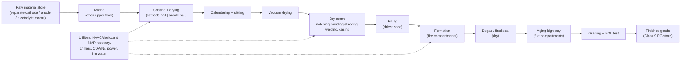
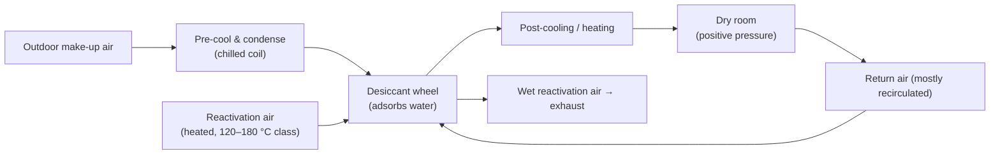

# Module 11 — Factory Layout, Dry Rooms and Safety Zoning

*Li-ion Cell Manufacturing: an Engineer's Course · Phase C · Evidence labels: [V] verified · [T] typical practice · [E] estimate · [P] proprietary*

**Bottom line:** a cell plant layout is driven by three gradients — **moisture** (driest at assembly/filling), **cleanliness** (no metal particles near open electrodes) and **fire risk** (highest where charged cells sit for days). Material should flow in one direction through these zones; people should cross them as little as possible, because every person is a moisture and particle source.

---

## 1. Concept

Picture a long building: powders enter at one end, finished cells leave at the other. Each hall has its own climate: controlled humidity for mixing and coating, ultra-dry air for cutting and assembly, warm and fire-separated for formation and aging, and a dangerous-goods warehouse at the exit.

## 2. Conceptual layout and material flow

**Layout principles [T]:**
- **One-way flow** from raw material to shipping; no back-flow of product.
- **Cathode and anode separated** from receipt to slitting (separate rooms, equipment, tools and often gowning colours) to stop copper/graphite reaching cathode and vice versa.
- **Vertical flow** is common: mixing on an upper floor so slurry feeds coaters by gravity/short pipes.
- **Long rectangular coater halls**: coaters with ovens are 50–100+ m long.
- **Dry-room volume minimised**: only processes that truly need it sit inside; use mini-environments (local enclosures) where possible — a big energy lever.
- **Formation and aging in fire compartments** with separation walls and automated removal of abnormal trays.
- **Utilities on the periphery or a mezzanine**, with short duct runs to the dry rooms.
- **Expansion axis**: leave space to add a full line (phase 2) without crossing flows.

## 3. Area-by-area requirements

| Area | Main hazards / sensitivities | Environment | Key design features |
| --- | --- | --- | --- |
| Raw material store | Moisture pickup, dust, chemical hazards (electrolyte flammable, LiPF₆ water-reactive) | Dry, cool; electrolyte in flammable-liquid store | Segregation, ventilation, spill containment |
| Mixing | Dust explosion/inhalation, NMP vapour, metal contamination | Humidity-controlled; local extraction | Contained powder handling, solvent-rated electrics where NMP is used, metal-free contact parts |
| Coating & drying | NMP vapour, heat, LEL in ovens | Clean, humidity-controlled | Oven LEL monitoring, NMP recovery, fire detection |
| Calender & slitting | Particles, noise | Clean; slitting often already in dry room | Dust extraction, particle monitoring |
| Dry room (assembly) | Moisture, particles, weld fumes | Dew point ~−35 to −45 °C class, down to −60 °C for sensitive steps **[T]** | Airlocks, pressure cascade, gowning, limited headcount |
| Filling | Moisture, electrolyte vapour, HF | Driest zone | Local exhaust, HF/solvent monitoring |
| Formation | Charged cells, thermal runaway, gas | Temperature-controlled; normal humidity | Fire compartments, cell-level monitoring, suppression, smoke exhaust |
| Aging | Large charged inventory | Temperature-controlled | AS/RS with fire zoning, rapid isolation |
| Grading / EOL | Charged cells handling | Normal | ESD, safety interlocks |
| FG warehouse | Dangerous goods (Class 9) | Cool, dry | Rack spacing, sprinklers, segregation |

## 4. Dry rooms in depth

### 4.1 Why dew point, not RH

At these moisture levels relative humidity is near zero and meaningless; **dew point** (the temperature at which water would condense) directly expresses absolute moisture. ~1% RH at room temperature corresponds to roughly −40 °C dew point **[V]** ([igus whitepaper](https://blog.igus.ca/wp-content/uploads/2026/05/USA_dry-cleanroom-batteries_whitepaper.pdf)). AFRY gives −35 to −45 °C during assembly, equal to ~0.11–0.28 g water per kg dry air **[V]** ([AFRY](https://afry.com/en/insight/clean-room-atmosphere-requirements-battery-production)).

### 4.2 How a dry room works

- Below ~0 °C dew point, cooling coils alone cannot dry the air; **desiccant rotors** are required **[V]** (AFRY).
- Rooms run at **positive pressure** with an airlock cascade so leakage goes out, not in **[V]** (patent example: dew point ≤ −40 °C with overpressure, [USPTO 12719139](https://image-ppubs.uspto.gov/dirsearch-public/print/downloadPdf/12719139)).
- **Moisture loads:** people (breathing, skin), make-up air, door openings, leaks through walls/cable entries, materials brought in, and process equipment **[T]**. People are a major internal source, so headcount and activity in dry rooms are controlled **[T]**.
- **Energy:** dry rooms and electrode drying are the two largest energy users in cell production **[V]** ([Linköping SIMS 2021](https://ecp.ep.liu.se/index.php/sims/article/view/347)); the reactivation heat for desiccant wheels is the main cost **[T]**.

### 4.3 Electrode area vs assembly area

| | Electrode manufacturing (mixing → calendering) | Cell assembly + filling |
| --- | --- | --- |
| Why moisture matters | Powders and slurries absorb water; high-Ni slurries gel; water-based anodes are made with water anyway | Electrodes are dry and about to meet LiPF₆; any water becomes HF in a sealed cell |
| Typical control | Humidity-controlled clean rooms (RH limits; drier for high-Ni) **[T]** | Dew point ~−35 to −45 °C, down to −60 °C for the most sensitive steps **[T]** |
| Volume | Large halls | Minimise volume; use mini-environments |
| Cost driver | Ventilation and solvent safety | Desiccant reactivation energy |

### 4.4 Cleanliness

Particles, especially metallic ones, are the main micro-short cause. Typical practices **[T]**: ISO 14644 cleanroom classes (ISO 7–8 class common for assembly; ABN supplies ISO 8 standard with ISO 7 option **[V]** ([Cleanroom Technology](https://www.cleanroomtechnology.com/abn-launches-ready-to-use-low-dewpoint-cleanroom-solution-for-the-eu-208283))), gowning, tacky mats, metal-free tools (ceramic, plastic), copper/brass/zinc bans in cathode zones, particle counters on SPC, and dust extraction at every cutting and welding station.

## 5. Personnel and material flow

| Topic | Practice **[T]** |
| --- | --- |
| Personnel entry | Gowning rooms, air showers, airlocks; separate entries per zone; badge-controlled; headcount limits |
| Material entry | Pass-through airlocks with purge; wipe-down; packaging removed outside the dry room |
| Flow separation | Product flow and people flow do not cross where possible; maintenance access from service corridors |
| Waste | Separate exits for scrap electrodes (contain cobalt/nickel), contaminated solvent, defective cells (charged → special handling) |

## 6. Fire protection and safety zoning

| Area | Hazard | Typical measures **[T]** |
| --- | --- | --- |
| NMP coating/recovery | Combustible solvent vapour (NMP flash point ~ 90 °C class **[T]**) | LEL monitoring in ovens, interlocks, rated electrics where required |
| Electrolyte storage and filling | Highly flammable carbonate solvents (e.g. DMC flash point below room temperature **[T]**), HF formation | Flammable-liquid rooms, spill containment, gas detection, local exhaust |
| Formation and aging | Thermal runaway of charged cells, toxic and flammable gases | Fire compartments, cell-level voltage/temperature monitoring, early smoke/off-gas detection, sprinklers or water deluge, automated removal of abnormal trays to quarantine, smoke exhaust |
| FG warehouse | Large charged inventory | Rack spacing, in-rack sprinklers, limited SOC |
| Whole plant | Electrical, chemical | HAZOP at design, emergency plans, local fire brigade coordination |

In India, design follows National Building Code fire provisions, PESO for petroleum/solvent storage where applicable, the Factories Act and state fire-service approvals; international insurers' guidance is often applied too **[T — confirm with your plant's EHS team]**.

## 7. Factory example

A new plant misses its dew-point target (−45 °C) in the monsoon. Moisture-load analysis shows the design assumed 20 people in the assembly dry room; during ramp-up, 45 engineers and OEM technicians were inside, plus doors propped open for cable pulling. **Fix:** temporary headcount cap with badge counting, door interlocks, sealing of cable penetrations, a temporary dehumidifier for ramp-up. **Lesson:** dry-room design loads must include commissioning-phase occupancy, not just steady-state production.

## 8. Interview questions

1. How does a desiccant-wheel dehumidifier achieve a −50 °C dew point?
2. Why is the dry room kept at positive pressure, and how do airlocks work in a cascade?
3. What are the main moisture sources in a dry room, and which can you control?
4. How would you reduce dry-room energy consumption?
5. Why separate cathode and anode flows, and how far upstream?
6. Describe fire zoning for a formation hall.

## 9. Quiz

1. Roughly what dew point corresponds to 1% RH at room temperature?
2. Below what dew point are desiccant dehumidifiers necessary?
3. Which area holds the largest stock of charged cells?
4. Why ban brass tools in cathode areas?
5. What is a mini-environment?

Answers

1. About −40 °C **[V]**.
2. Below about 0 °C dew point **[V]**.
3. Aging (and FG warehouse).
4. Copper/zinc particles dissolve and plate → micro-shorts.
5. A small sealed enclosure around a process with its own dry/clean air, reducing the big room's requirement.

## 10. Hands-on exercise

Draw a block layout (to rough scale) for a 5 GWh/yr LFP prismatic plant on a 300 × 150 m plot. Show: zones, dew-point classes, airlocks, people and material entry points, fire compartments, utility yard, expansion space for phase 2. Then list the five largest moisture loads for the assembly dry room and how you would control each.

## Sources

- [AFRY — clean and dry room requirements](https://afry.com/en/insight/clean-room-atmosphere-requirements-battery-production)
- [igus — dry cleanrooms whitepaper](https://blog.igus.ca/wp-content/uploads/2026/05/USA_dry-cleanroom-batteries_whitepaper.pdf)
- [Cleanroom Technology — ABN dry room solution](https://www.cleanroomtechnology.com/abn-launches-ready-to-use-low-dewpoint-cleanroom-solution-for-the-eu-208283)
- [Linköping SIMS 2021 — energy of electrode drying and dry room](https://ecp.ep.liu.se/index.php/sims/article/view/347)
- [USPTO 12719139 — dry room at overpressure, dew point ≤ −40 °C](https://image-ppubs.uspto.gov/dirsearch-public/print/downloadPdf/12719139)

**Next:** [Module 12 — Parameter handbook, quality and PFMEA](12-parameters-quality-pfmea.md)
