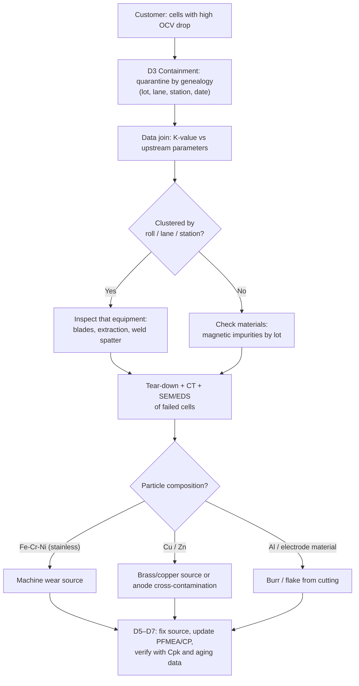

# Module 13 — Defect and Troubleshooting Guide, Failure Analysis

*Li-ion Cell Manufacturing: an Engineer's Course · Phase C · Evidence labels: [V] verified · [T] typical practice · [E] estimate · [P] proprietary*

**Bottom line:** most cell defects end up in one of four symptoms at EOL — **low capacity, high resistance, high self-discharge, or swelling/leak**. Troubleshooting is the art of walking back from the symptom to the stage, using genealogy data first and tear-down second.

---

## 1. Symptom → stage map

```mermaid
flowchart TD
    S1["High self-discharge<br/>(K-value)"] --> C1["Particle / burr / separator damage<br/>→ stages 1, 2, 6, 7"]
    S1 --> C2["Metallic contamination dissolving<br/>→ stages 1, 2"]
    S1 --> C3["Lithium plating / dendrite<br/>→ stages 3, 7, 9"]
    S2["Low capacity"] --> D1["Low coat weight → stage 3"]
    S2 --> D2["Under-fill / poor wetting → stage 8"]
    S2 --> D3["Lithium loss: plating, moisture,<br/>high-BET anode → 1, 8, 9"]
    S3["High resistance"] --> E1["Weak tab/terminal weld → 7"]
    S3 --> E2["Over-densified electrode,<br/>binder migration → 4, 5"]
    S3 --> E3["Low electrolyte → 8, 10"]
    S4["Swelling / leak"] --> F1["Moisture / residual solvent → 1, 4, 6, 8"]
    S4 --> F2["Seal or weld defect → 7, 10"]
    S4 --> F3["Gas from high-Ni residual Li → 1, 2"]
```

## 2. Defect guide

| Defect | Root causes | Stage | Detection | Performance impact | Safety impact | Prevention / corrective action |
| --- | --- | --- | --- | --- | --- | --- |
| **Electrode coating defects** (streaks, pinholes, thickness variation) | Agglomerates, bubbles, die lip damage, pump pulsation, foil contamination | 2–3 | Inline vision, β-gauge, profile | Local capacity mismatch, early fade | Local plating at thin anode spots | Filtration, degassing, lip PM, pulsation damping, auto-skip marked areas |
| **Electrode cracks** | Fast drying (capillary stress), thick water-based films, low binder, over-calendering | 4–5 | Vision, microscopy | Loss of contact, capacity fade | Particle shedding → shorts | Low–high–low drying, binder level, compaction limits |
| **Poor adhesion / delamination** | Binder migration, foil oil/oxide, under-drying, calender shear | 3–5 | Peel test, tape test | Capacity loss, high IR | Loose particles | Drying profile, foil cleanliness spec (dyne), primer layer |
| **Burrs** | Worn knives/dies, wrong setup, laser beads | 6 | Microscopy, vision | — | Separator puncture → internal short | Tool life by metres, burr SPC, laser windows |
| **Misalignment** | Web wander, width error, placement error, telescoping | 6–7 | CCD, X-ray/CT | Capacity loss at edges | Plating at uncovered anode edges, shorts at edges | EPC, vision feedback, tolerance stack-up design |
| **Tab welding defects** | Horn/anvil wear, contamination, wrong energy; laser porosity/spatter | 7 | Weld signature, peel/pull, cross-section, IR | High resistance, heating | Hot spots; spatter particles → shorts | Signature monitoring, PM by count, cleaning |
| **Separator damage** | Burrs, particles, tension spikes, gripper damage, heat (hot press, welding) | 6–7 | Hi-pot, visual, CT | — | Hard short / thermal event | Tension control, clean handling, heat shields |
| **Electrolyte filling defects** (under/over-fill, spill, incomplete wetting) | Pump wear, bubbles, nozzle crystallisation, short soak | 8 | Weighing, formation curves | Fade, high IR, capacity spread | Plating (dry spots); seal failures from spill | Pump PM, 100% weighing, wetting validation, wipe station |
| **Moisture contamination** | Wet materials, dew-point excursion, long exposure, bad vacuum drying | 1, 6, 8 | KF, dew-point logs, gas at formation | Fade, gas, IR rise | HF, gas, venting | Moisture interlocks, exposure clocks, dew-point SPC |
| **Internal short circuits** | Metal particles, burrs, separator defects, lithium dendrites | 1–9 | Hi-pot, OCV drop, temperature at formation | Self-discharge | Thermal runaway risk | Prevention at source (contamination control), screening at hi-pot and aging |
| **Gas generation** | Moisture, residual NMP, residual Li (high-Ni), electrolyte decomposition, over-voltage | 1, 2, 4, 8, 9 | Thickness, pressure, GC of gas | Swelling, contact loss | Venting | Moisture/solvent control, additive tuning, formation recipe |
| **Capacity loss** | Low loading, lithium lost to SEI/plating, under-fill, high-BET anode | 3, 8, 9 | Grading capacity, formation efficiency | Low-grade cells | — (unless plating) | Coat weight control, formation recipe, material specs |
| **High internal resistance** | Weak welds, over-densified electrodes, binder-rich surface, low electrolyte, low temperature formation | 4, 5, 7, 8 | ACIR/DCIR | Low power, heating | Hot spots | Weld control, density targets, fill mass |
| **Leakage** | Seal channels, weld pores, damaged pouch, seal-pin weld defects | 7, 10 | He leak, vacuum decay, weight loss, smell | Electrolyte loss → fade | Flammable electrolyte outside cell, moisture ingress | Seal-area cleanliness, weld monitoring, 100% leak test (prismatic) |
| **Abnormal self-discharge** | Micro-shorts (particles, burrs), dissolved metals, shuttle reactions from impurities | 1–9 | K-value (OCV drop), dynamic limits | Imbalance in packs, reduced range | Possible latent short → thermal event | Contamination control, longer aging for LFP, dynamic limits, µV meters |

## 3. Failure analysis toolbox

| Method | Destructive? | What it shows |
| --- | --- | --- |
| OCV/ACIR/DCIR, capacity | No | Electrical symptom |
| dQ/dV and differential voltage analysis | No | Lithium loss vs active-material loss; plating signatures |
| EIS (impedance spectroscopy) | No | Interface vs bulk resistance; wetting |
| X-ray / CT | No | Alignment, overhang, particles, tab position, deformation |
| Thickness / pressure mapping | No | Swelling, gas |
| Tear-down in glovebox / dry room | Yes | Visual: plating (grey/silver deposits), dry spots, delamination, separator holes |
| SEM / EDS | Yes | Particle morphology and composition (Fe, Cr, Ni → stainless; Cu; Zn) |
| ICP-OES/MS | Yes | Metal content in electrolyte or electrodes |
| GC-MS of gas or electrolyte | Yes | Gas composition, electrolyte decomposition |
| XPS | Yes | SEI chemistry |

## 4. Troubleshooting flow — self-discharge escape (8D style)

## 5. Factory example

Pouch cells swell 0.3 mm more than spec at grading, worst in cells made on Mondays. Genealogy: Monday cells used electrode rolls vacuum-dried on Friday and left in the dry-room buffer over the weekend. Dew-point logs show the HVAC setback mode raised dew point to −30 °C on weekends to save energy. **Root cause:** moisture re-absorption during buffer time; HF and gas at formation. **Actions:** no HVAC setback in zones holding product; maximum buffer time interlock in MES; re-dry rule for rolls older than the limit.

## 6. Interview questions

1. A cell shows low capacity and high resistance together. What are your top three hypotheses and what data do you check first?
2. How do you distinguish lithium inventory loss from active-material loss without tear-down?
3. SEM/EDS finds Fe, Cr, Ni on a separator hole. What does that tell you?
4. Why does plating at the anode edge point to an assembly problem?
5. How do you design containment when the defect shows two weeks after it was made?

## 7. Quiz

1. Which non-destructive method shows overhang inside a sealed cell?
2. What does a grey/silver deposit on a torn-down anode suggest?
3. Name two causes of gas generation.
4. Which symptom does a weak tab weld cause?
5. Which data link makes containment by root cause possible?

Answers

1. X-ray / CT.
2. Lithium plating.
3. Moisture, residual NMP, residual Li on high-Ni CAM, electrolyte decomposition (any two).
4. High resistance (ACIR/DCIR).
5. Cell-level genealogy (traceability).

## 8. Hands-on exercise

Build a **troubleshooting matrix** (symptom rows × stage columns) and score how likely each stage is to cause each symptom (0–3). Use it to design a dashboard: for each EOL symptom, which upstream data views should open automatically? Then write a one-page 8D for the Monday swelling example above.

**Next:** [Module 14 — Economics and factory operations](14-economics-and-operations.md)
