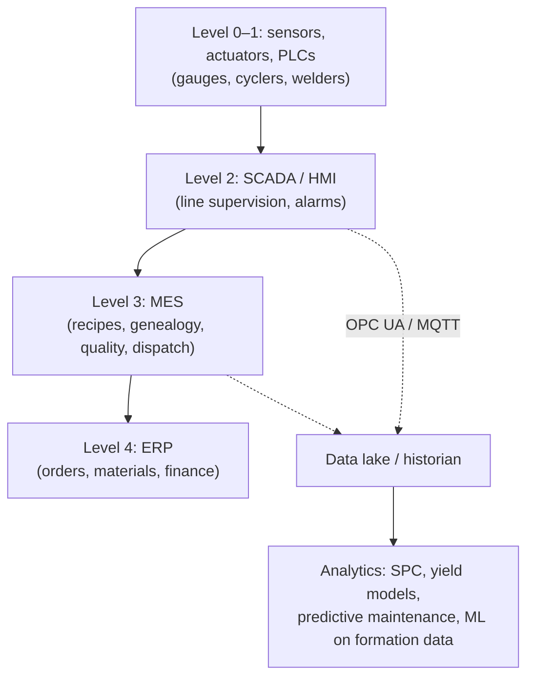

# Module 14 — Manufacturing Economics and Factory Operations

*Li-ion Cell Manufacturing: an Engineer's Course · Phase D · Evidence labels: [V] verified · [T] typical practice · [E] estimate · [P] proprietary*

**Bottom line:** cell cost is mostly **materials**; the factory's job is to waste as little of them as possible (yield) and spread a large **capital** bill over as many kWh as possible (utilisation). In the illustrative India LFP model below, material is ~55–65% of cost, capital ~22–27%, and labour only ~1–2.5%. That is why yield, uptime and capex efficiency — not labour cost — decide whether an Indian plant can compete with China.

The companion spreadsheet **`Cell_Cost_Model_1-5-10GWh.xlsx`** (same folder) has every input in yellow cells with live formulas.

---

## Part A — Economics

### A1. Market anchors (verified)

| Fact | Value | Source |
| --- | --- | --- |
| Average Li-ion pack price, 2025 | $108/kWh (−8% vs 2024) | [BNEF, Dec 2025](https://about.bnef.com/insights/clean-energy/lithium-ion-battery-pack-prices/) **[V]** |
| LFP vs NMC pack average | $81/kWh vs $128/kWh | BNEF **[V]** |
| Stationary storage packs | $70/kWh (−45%) | BNEF **[V]** |
| China average pack price | $84/kWh; North America +44%, Europe +56% | BNEF **[V]** |
| Gigafactory capex | ~$80 per kWh of annual capacity (~40 projects); China lowest, US/Japan >2× China | [Thunder Said Energy](https://thundersaidenergy.com/downloads/battery-gigafactory-capex-costs/) **[V]** |
| Capex cost in cell price | Amortisation ~$8/kWh plus ~$8–12/kWh for a 10% return | Thunder Said **[V]** |
| Staffing | ~70 FTE per GWh/yr; labour ~$6/kWh in the West vs $1–2/kWh in China/emerging markets | Thunder Said **[V]** |
| Coating + drying share | ~11.5% of manufacturing cost, ~46% of energy | [EEPower/ORNL](https://eepower.com/market-insights/researchers-validate-benefits-of-dry-processing-in-lithium-ion-battery-manufacturing/) **[V]** |
| Plant energy | ~44.6 Wh per Wh capacity (2 GWh NMC333 model), 47 ± 13 Wh/Wh across types | [SINTEF](https://sintef.no/en/publications/publication/1892466) **[V]** |
| Indian reference | Exide's cumulative equity in its cell subsidiary ₹4,902 crore (July 2026) for a 6 GWh phase 1 designed to expand to 12 GWh | [Dealroom](https://dealroom.co/news/140011-exide-pumps-another-100-crore-into-battery-arm-ahead-of-gigafactory-laun/) **[V]** — equity is not identical to capex, but implies ~₹800 crore per GWh order |

### A2. Cost vocabulary

| Term | Meaning |
| --- | --- |
| CAPEX | Buildings, dry rooms, utilities, equipment, installation, commissioning |
| OPEX | Materials, energy, labour, maintenance, consumables, overheads |
| Conversion cost | Cell cost minus materials — what the factory "adds" |
| Yield | Good output ÷ input; multiplies through stages (e.g. 12 stages at 99.3% each ≈ 92%) |
| Utilisation | Actual output ÷ nameplate capacity |
| Cost per kWh vs per cell | Per cell = per kWh × kWh per cell |

### A3. Illustrative cost model — LFP prismatic, India greenfield **[E]**

**Assumptions (all [E] unless noted):** 280 Ah × 3.2 V = 0.896 kWh/cell; capex $90/$75/$65 per kWh of annual capacity for 1/5/10 GWh (anchored to the ~$80/kWh global average **[V]**); capital charge 20% of capex per year (10-year depreciation + 10% return, consistent with Thunder Said **[V]**); utilisation 80%; base material $42/kWh at 100% yield (BNEF LFP pack $81/kWh × ~75% cell share × ~70% material share); yield 88/92/94%; staffing 150/90/70 FTE per GWh at $10,000 per FTE-year; energy 50/40/35 kWh per kWh at $0.09/kWh; maintenance 3% of capex per year; other overheads $3.0/2.5/2.0 per kWh.

| USD per good kWh | 1 GWh | 5 GWh | 10 GWh |
| --- | --- | --- | --- |
| Material (÷ yield) | 47.7 | 45.7 | 44.7 |
| Capital charge | 22.5 | 18.8 | 16.3 |
| Labour | 1.9 | 1.1 | 0.9 |
| Energy | 4.5 | 3.6 | 3.2 |
| Maintenance | 3.4 | 2.8 | 2.4 |
| Other overhead | 3.0 | 2.5 | 2.0 |
| **Total cell cost** | **83.0** | **74.4** | **69.4** |
| Conversion cost | 35.3 | 28.8 | 24.7 |
| **Cost per cell (0.896 kWh)** | **$74.3** | **$66.7** | **$62.2** |
| Total capex | $90 M | $375 M | $650 M |

**Reading it:** scale cuts ~$14/kWh from 1 to 10 GWh, almost all from capital and yield. Compare with BNEF's China average *pack* price of $84/kWh: an Indian 1 GWh plant on these assumptions would produce *cells* at roughly China's *pack* price — the scale and supply-chain gap in one number.

### A4. Sensitivity (5 GWh case) **[E]**

| Change | Total $/kWh | Δ vs base 74.4 |
| --- | --- | --- |
| Utilisation 60% | 82.0 | +7.6 |
| Utilisation 90% | 71.9 | −2.5 |
| Capex −40% (China-like) | 65.8 | −8.6 |
| Yield 85% | 78.2 | +3.8 |
| Yield 96% | 72.5 | −1.9 |
| Material −10% | 69.9 | −4.5 |
| Material +10% | 79.0 | +4.6 |

The biggest levers for an Indian plant are **capex efficiency, utilisation (ramp speed) and materials localisation**; labour is almost irrelevant.

### A5. Yield economics

- Scrap value depends on where it happens: electrode scrap before assembly loses materials and some processing; a cell rejected at grading loses everything plus 1–3 weeks of rack time.
- Each yield point at 5 GWh is worth roughly 0.5% of cost (~$0.5/kWh) in this model — i.e. ~$2 M/yr at 4 GWh output **[E]**.
- Ramp-up: new plants typically take 12–24 months to approach mature yields **[T]**; many failed gigafactory projects outside Asia struggled exactly here **[T]**.

## Part B — Factory operations

### B1. Planning hierarchy

| Level | Horizon | Question |
| --- | --- | --- |
| Capacity planning | Years | How many lines/racks for the demand curve; phase 2 timing |
| Production planning (S&OP) | Months | Which cell types, which customers, material call-offs |
| Scheduling | Days/shifts | Coater campaigns (cathode/anode, recipes), changeovers, formation slot booking |
| Execution | Real time | MES dispatch, quality holds |

Coaters run **campaigns** (long runs of one recipe) because changeovers waste foil and slurry; formation is booked like hotel rooms.

### B2. Takt, cycle time, bottleneck, OEE

- **Takt** = available time ÷ required output (Module 10 example: ~4.6 s/cell at 5 GWh).
- **Cycle time** per machine; parallel machines where cycle > takt.
- **Bottleneck**: commonly stacking/winding in assembly and formation capacity in finishing **[T]**; protect it with buffers and priority maintenance.
- **OEE** = Availability × Performance × Quality. Track per coater lane and per assembly machine; use the six big losses as in automotive. Electrode lines lose OEE to splices, roll changes and start-up scrap; assembly to micro-stops and jams; formation to contact faults and empty channels **[T]**.

### B3. Yield improvement system

1. Stage-level first-pass yield dashboard, multiplied into overall yield.
2. Daily scrap Pareto by defect code and station.
3. Inline defect maps tied to cell IDs → find which upstream defects really cause EOL failures, stop chasing harmless cosmetic ones.
4. DOE and SPC on special characteristics; Cpk reviews.
5. Golden-batch comparison: parameter fingerprints of the best days.

### B4. Digital manufacturing stack

| System | Role in a cell plant |
| --- | --- |
| **MES** | Recipe management and locking, electronic batch records, cell-level genealogy (roll → lane → position → cell ID), quality holds, exposure-time clocks, formation slot management |
| **SCADA** | Real-time line monitoring, alarms, energy and dry-room monitoring |
| **Equipment data collection** | OPC UA / MQTT from every machine; high-frequency gauges and cycler data |
| **Predictive maintenance** | Vibration and temperature on calender bearings, coater pumps, fans; weld signatures; laser power trends; cycler channel health |
| **Traceability** | Laser-marked codes; roll-position mapping so a vision defect at metre 1,250 of lane 3 is linked to specific cells |
| **Digital twin / simulation** | Line balancing, buffer sizing, energy optimisation (e.g. PEM's virtual configuration of cell finishing **[V]** — [Electrive](https://www.electrive.net/2025/10/08/pem-zeigt-virtuelles-modell-zur-optimierung-der-batteriezellfertigung/)) |

### B5. Roles

| Role | Owns |
| --- | --- |
| **Process engineer** | Recipes and windows for a stage (e.g. coating), DOE, process capability, PFMEA content |
| **Equipment engineer** | Machine performance, uptime, PM plans, spare parts, OEM interface, upgrades |
| **Manufacturing engineer** | Line layout, flow, takt/balancing, new-line industrialisation, cost |
| **Quality engineer** | Control plans, SPC, MSA, audits, customer complaints, 8D, PPAP |
| **Production engineer / supervisor** | Daily output, shift performance, people, standard work |
| **Data/automation engineer** | MES, SCADA, data pipelines, analytics |

With your background, the natural entry roles are manufacturing engineering, quality engineering or a costing/industrial-engineering role that combines both — the cost model above is exactly the kind of analysis those teams own.

## Interview questions

1. Which cost lever matters most for an Indian cell plant and why?
2. Explain why utilisation affects cost per kWh so strongly.
3. How would you calculate takt time and size formation for a new plant?
4. What data must the MES capture for cell-level traceability?
5. How do you prioritise yield-improvement projects?
6. What is conversion cost, and what is a competitive level?

## Quiz

1. BNEF 2025 average LFP pack price?
2. Average gigafactory capex per kWh of annual capacity per Thunder Said?
3. In the illustrative model, what share of 5 GWh cost is material?
4. OEE formula?
5. Which ISA-95 level is MES?

Answers

1. $81/kWh **[V]**.
2. ~$80/kWh **[V]**.
3. ~61% (45.7 / 74.4) **[E]**.
4. Availability × Performance × Quality.
5. Level 3.

## Hands-on exercise

Open `Cell_Cost_Model_1-5-10GWh.xlsx` and (a) switch the 5 GWh case to an NMC chemistry with base material $60/kWh and capex $85/kWh **[E]**; (b) find the utilisation at which the 5 GWh plant matches the 10 GWh base cost; (c) build a column chart of the cost stack for the three plant sizes; (d) write a half-page memo on what an Indian plant must do to approach China-level cost.

**Next:** [Module 15 — Global and Indian ecosystem](15-global-and-indian-ecosystem.md)
