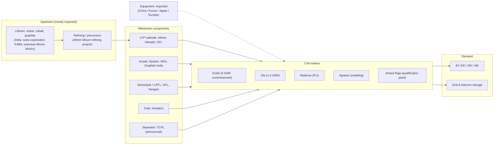

# Module 15 — Global and Indian Cell Manufacturing Ecosystem

*Li-ion Cell Manufacturing: an Engineer's Course · Phase D · Evidence labels: [V] verified · [T] typical practice / general knowledge, not re-checked this session · [E] estimate · [P] proprietary*

**Bottom line:** global cell supply is concentrated — CATL and BYD alone installed ~56% of EV battery GWh in 2025. India has moved from announcements to its first commissioned lines in 2026, but operating capacity remains a small fraction of what is announced, and almost all materials and equipment are still imported. **Always separate announced, under-construction, installed, commissioned and producing capacity** — they are different numbers.

---

## Part A — Global market

### A1. EV battery installations 2025 (SNE Research via CnEVPost) **[V]**

Total: **1,187 GWh** (+31.7% vs 901.4 GWh in 2024). Source: [CnEVPost, Feb 2026](https://cnevpost.com/2026/02/04/global-ev-battery-market-share-2025/).

| Rank | Company | GWh | Share |
| --- | --- | --- | --- |
| 1 | CATL | 464.7 | 39.2% |
| 2 | BYD | 194.8 | 16.4% |
| 3 | LG Energy Solution | 108.8 | 9.2% |
| 4 | CALB | 62.8 | 5.3% |
| 5 | Gotion High-tech | 53.5 | 4.5% |
| 6 | SK On | 44.5 | 3.7% |
| 7 | Panasonic | 44.2 | 3.7% |
| 8 | EVE Energy | 31.3 | 2.6% |
| 9 | Samsung SDI | 28.9 | 2.4% |
| 10 | SVOLT | 28.5 | 2.4% |

These are EV installations only; ESS cells (where EVE, CATL, BYD, Hithium and others are large) are counted separately.

### A2. Company profiles

Capacity figures are given only where verified; other entries are well-known public facts from general knowledge **[T]** — check the latest annual report before quoting.

| Company | Chemistry | Formats | Key manufacturing locations | Capacity | Technology differentiation | Notes |
| --- | --- | --- | --- | --- | --- | --- |
| **CATL** (China) | LFP, NMC, sodium-ion | Prismatic (mainly), some cylindrical | Many sites in China; Germany (Arnstadt), Hungary (Debrecen), Spain JV, Indonesia **[T]** | 2025: **772 GWh** production capacity, **321 GWh** under construction, **661 GWh** sales **[V]** ([battery-tech.net](https://battery-tech.net/battery-markets-news/catl-releases-2025-annual-report/)) | Cell-to-pack, high-volume LFP, fast-charge LFP, sodium-ion commercialisation **[T]** | 2025 revenue RMB 423.7 bn, net profit RMB 72.2 bn **[V]** |
| **BYD** (China) | LFP (Blade), some NMC | Long prismatic "Blade" (stacked) | China; overseas vehicle plants with expanding cell supply **[T]** | Not verified this session | Vertical integration (cells → vehicles), blade cell-to-pack **[T]** | 194.8 GWh EV installs 2025 **[V]** |
| **LG Energy Solution** (Korea) | NMC/NCMA, LFP for ESS | Pouch, cylindrical (incl. 46-series), prismatic in development | Korea, China (Nanjing), Poland (Wrocław), US (Michigan, Arizona, JVs with GM, Honda, Hyundai, Stellantis) **[T]** | Not verified | Pouch NCMA, US localisation, ESS LFP production in Poland **[T]** ([Energy-Storage.news](https://energy-storage.news/pges-900mwh-bess-will-be-first-to-use-lgs-ess-batteries-produced-in-poland)) | |
| **CALB** (China) | NMC, LFP | Prismatic, cylindrical | China; Portugal project **[T]** | Not verified | High-voltage mid-Ni, "one-stop" prismatic **[T]** | |
| **Gotion** (China, VW is a major shareholder) | LFP mainly | Prismatic, cylindrical | China; projects in US, Europe (Germany), Morocco, Slovakia (InoBat JV) **[T]** | Not verified | LFP cost, JV-based expansion **[T]** | Partner to Amara Raja via Gotion-InoBat **[V]** ([Autocar Pro](https://autocarpro.in/news/amara-raja-to-invest-over-rs-1000-crore-for-li-ion-cell-biz-in-fy26-123411)) |
| **SK On** (Korea) | High-Ni NMC | Pouch (Z-fold stacking) | Korea, US (Georgia; BlueOval SK with Ford), Hungary, China **[T]** | Not verified | High-Ni pouch, Z-fold stacking **[T]** | |
| **Panasonic Energy** (Japan) | NCA | Cylindrical (2170, 4680-type) | Japan; US (Nevada with Tesla; Kansas De Soto, announced at 30 GWh **[V-2022 announcement]** ([Electrek](https://electrek.co/2022/10/31/panasonic-30-gwh-batteries-kansas-factory-supply-tesla/))) | Not verified | High-speed cylindrical manufacturing, high-Ni NCA **[T]** | |
| **EVE Energy** (China) | LFP, NMC | Cylindrical (incl. large 46-series), prismatic (ESS), pouch | China; Hungary, Malaysia **[T]** | Not verified | Strong in ESS LFP and small cylindrical **[T]** | |
| **Samsung SDI** (Korea) | NCA/NCM | Prismatic, cylindrical | Korea, Hungary, China, US (JVs with Stellantis, GM) **[T]** | Not verified | Prismatic high-Ni, solid-state R&D **[T]** | |
| **AESC** (China/Japan) | NMC, LFP | Pouch, prismatic | Japan, UK (Sunderland), France (Douai), Spain, US, China **[T]** | Not verified | Long pouch heritage (Nissan Leaf), European/US localisation **[T]** | |

**Equipment suppliers (publicly confirmed links are rare).** Equipment supplier–cell maker pairings are mostly not disclosed; the verified market picture is: Chinese suppliers held 68% of top-25 equipment sales in 2024 (72% in assembly, 70% in formation/testing), Korean suppliers 29% overall and ~40% in electrode equipment, with PNT second globally in front-end equipment **[V]** ([Control Engineering](https://www.controleng.com/battery-equipment-market-shifts-open-new-competitive-paths/)). Lead Intelligent is widely reported as the largest Chinese line supplier **[T]**.

## Part B — India

### B1. Policy

| Policy | Key facts | Source |
| --- | --- | --- |
| **ACC PLI** (Ministry of Heavy Industries) | Launched Oct 2021; ₹18,100 crore outlay; 50 GWh target. Round 1 (Mar 2022) allocated 50 GWh; Hyundai Global Motors withdrew from 20 GWh; round 2 (Sep 2024) awarded 10 GWh. 40 GWh allocated in total | [IEEFA, Jan 2026](https://ieefa.org/articles/only-28-target-capacity-delivered-yet-under-indias-battery-manufacturing-incentive-scheme) **[V]** |
| PLI status | As of Oct 2025: 1.4 GWh (2.8%) commissioned on time, all Ola; no incentives disbursed; 1,118 jobs vs 1.03 M estimated; investment ~₹2,870 crore committed (25.6% of target) | IEEFA **[V]** |
| PLI conditions | Domestic value addition (25% in 2 years, 60% in 5 years), two-year installation timeline, daily penalty on delays | [Vision IAS summary](https://visionias.in/current-affairs/upsc-daily-news-summary/article/2026-01-24/the-hindu/schemes-in-news/ambitious-scheme-to-spur-next-gen-battery-manufacturing-in-india-stumbles), IEEFA **[V]** |
| New 10 GWh tender | Bids invited July 2026 (submission 13 Oct, opening 14 Oct 2026), earmarked for grid-scale storage | [GreentechLead](https://greentechlead.com/electric-vehicle/india-ev-and-battery-investments-2026-tata-amara-raja-and-exide-expand-gigafactory-plans-55902) **[V]** |
| Cell-component scheme | ~₹12,000–13,000 crore proposed for cathode, anode, separator, foil, electrolyte; not yet gazetted | [Swarajya](https://swarajyamag.com/technology/cathode-anode-separator-foil-electrolyte-can-government-incentives-help-india-crack-the-battery-code) **[V]** |
| Demand drivers | National Electricity Plan: 34 GWh BESS by 2026–27, 236 GWh by 2031–32; VGF support for 43.8 GWh; PM E-DRIVE (₹10,900 crore) | GreentechLead **[V]** |

### B2. Cell makers — status (October 2026)

| Company | Site | Plan | Status as reported | Chemistry / partner | Source |
| --- | --- | --- | --- | --- | --- |
| Exide Energy Solutions | Devanahalli, Bengaluru | 12 GWh (2 × 6 GWh) | **Phase I 6 GWh commissioned** (reported 28 Sep 2026); revenue targeted from Q3 FY27 | LFP prismatic first, NMC later; SVOLT technology licence; non-PLI | [Energetica India](https://www.energetica-india.net/news/exide-commissions-6-gwh-phase-i-lithium-ion-cell-manufacturing-facility), [Outlook Business](https://www.outlookbusiness.com/corporate/exide-targets-rs-20000-cr-core-business-revenue-by-fy28-eyes-q3-rollout-of-bengaluru-lithium-ion-plant) |
| Ola Cell Technologies | Krishnagiri, TN | 20 GWh PLI award; limited to 5 GWh until FY2029 | 1.4 GWh commissioned (Oct 2025) | 46-series cylindrical (Ola's "4680 Bharat Cell") **[T]**; PLI | IEEFA |
| Reliance New Energy | Jamnagar, Gujarat | 5 GWh (round 1) + 10 GWh (round 2) PLI | Round-2 indicated on time; round-1 delayed (Oct 2025) | PLI | IEEFA |
| Agratas (Tata) | Sanand, Gujarat | 20 GWh phase 1 | First process equipment arrived 16 Sep 2026 | — | GreentechLead |
| Amara Raja | Divitipally, Telangana | 16 GWh, ₹9,500 crore | ₹500 crore qualification plant (60 MWh) commissioned Jul 2026; 2 GWh commercial plant scheduled 2027 | NMC 2170 cylindrical with a Chinese partner; LFP with Gotion-InoBat; non-PLI | GreentechLead, Autocar Pro |

### B3. Components and materials (India)

| Segment | Indian players (status) | Source |
| --- | --- | --- |
| LFP cathode | Altmin (Telangana, ₹750 cr plant under construction), Himadri (Odisha, 40,000 t/yr by late 2027), Gujarat Fluorochemicals (small line commissioned) | Swarajya **[V]** |
| Anode | Epsilon Advanced Materials (qualification plant, ₹145 cr incentive), HEG (₹1,893 cr), Graphite India (₹4,330 cr) | Swarajya **[V]** |
| Separator | TCPL Packaging announced; no commercial Indian Li-ion separator plant yet | Swarajya **[V]** |
| Foils | Hindalco: battery Al foil (Odisha); 11,500 t copper foil announced (Gujarat) | Swarajya **[V]** |
| Electrolyte / LiPF₆ | Gujarat Fluorochemicals (LiPF₆ commercial at Dahej), Neogen Chemicals (electrolyte under licence; LiPF₆ with Morita) | Swarajya **[V]** |
| Equipment | Core process machines imported (China, Korea, Japan, Europe); Chinese commissioning engineers' visa delays slowed PLI plants | IEEFA **[V]** |
| Critical minerals | Lithium resources identified in J&K and Rajasthan; commercial mining long-dated; NMC CAM supply ~98% Chinese globally per one report | [MeraEV](https://www.meraev.com/blog/ev-battery-manufacturers-india), [Dealroom](https://dealroom.co/news/140011-exide-pumps-another-100-crore-into-battery-arm-ahead-of-gigafactory-laun/) |

### B4. Ecosystem map

### B5. Challenges

1. **Import dependence** across minerals, materials and equipment; dependence on imported cells still close to 100% (Oct 2025) **[V]** (IEEFA).
2. **Know-how gap:** none of the PLI winners had large-scale cell experience; Exide and Amara Raja (experienced battery makers) did not qualify **[V]** (IEEFA).
3. **Policy design:** aggressive two-year timelines and high DVA targets **[V]**.
4. **Scale and cost:** see Module 14 — small plants carry high capital cost per kWh.
5. **Testing and certification infrastructure** for cells is limited **[V]** (IEEFA recommends building it).
6. **Talent:** few engineers with dry-room, formation and electrode-process experience **[T]**.

### B6. Opportunities

- **Grid storage demand** (236 GWh by 2031–32) gives LFP plants a large domestic market **[V]**.
- **Component localisation** (cathode, anode, foil, electrolyte, cans, laminate film) as incentives arrive **[V]**.
- **Equipment and spares localisation**: tooling, slitting knives, dies, fixtures, trays, dry-room HVAC, intralogistics — areas where India's automotive supplier base can enter **[E]**.
- **Services:** commissioning, maintenance, testing labs, recycling (scrap from ramp-ups is valuable).
- **Careers:** process, quality, equipment and costing engineers with automotive discipline are scarce and needed now **[E]**.

## Interview questions

1. What is the difference between announced, installed, commissioned and producing capacity? Give an Indian example of each.
2. Why did ACC PLI under-deliver, and what would you change?
3. Which Indian component segment do you expect to localise first, and why?
4. Compare CATL's and LGES's technology strategies.
5. Why does LFP dominate Indian plans?

## Quiz

1. CATL's 2025 EV battery market share (SNE)?
2. Total global EV battery installations in 2025?
3. How much ACC PLI capacity was commissioned on time by Oct 2025?
4. Which Indian cell maker commissioned 6 GWh in Sep 2026?
5. Which Indian company makes LiPF₆ commercially?

Answers

1. 39.2% **[V]**.
2. 1,187 GWh **[V]**.
3. 1.4 GWh **[V]**.
4. Exide Energy Solutions **[V]**.
5. Gujarat Fluorochemicals **[V]**.

## Hands-on exercise

Build a one-page **capacity tracker** for Indian cell plants with columns: company, site, chemistry/format, announced GWh, under construction, installed, commissioned, producing, source and date. Fill it from this module, then search for one update per company and record what changed. This is the discipline the brief asked for: never mix stages of capacity.

**Next:** [Module 16 — Capstone: interview guide, glossary, resources](16-capstone-interview-glossary-resources.md)
